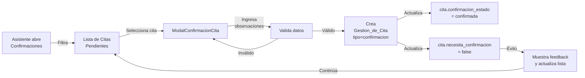
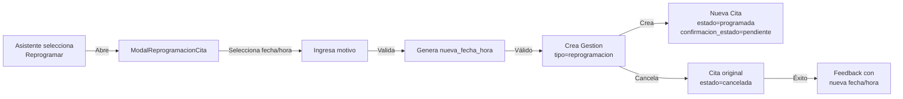
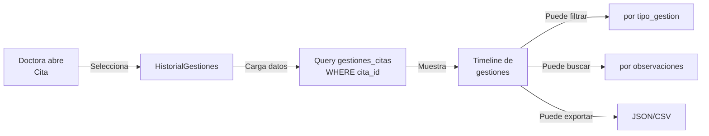

# Design Document

## Overview

Este documento describe la arquitectura técnica, modelo de datos y componentes para implementar el feature "Gestión de Confirmación de Citas Odontológicas" en DentiFlow.

**Objetivo**: Permitir que la asistente identifique citas pendientes de confirmación, registre confirmaciones, cancelaciones y reprogramaciones, y documente el historial completo de gestiones para reducir inasistencias y mejorar la organización de la agenda.

**Stack Tecnológico**: React + TypeScript + Tailwind CSS (Frontend) | Supabase PostgreSQL + RLS (Backend) | Timezone: America/Managua

---

## Architecture

### Stack Tecnológico (Consistente con SPEC-001)

```
┌─────────────────────────────────────────────────────────────┐
│                    FRONTEND (React + TS)                    │
│  ├─ Pages (Confirmaciones, Gestiones, Historial)           │
│  ├─ Components (Modales, Tablas, Alertas, Badges)          │
│  └─ Hooks (useGestiones, useCitasPendientes, etc.)         │
└────────────────────────┬────────────────────────────────────┘
                         │ (HTTPS REST API)
┌────────────────────────▼────────────────────────────────────┐
│            SUPABASE (Backend as a Service)                  │
│  ├─ Supabase Auth (Autenticación Asistente/Doctora)        │
│  ├─ PostgreSQL Database                                     │
│  │  ├─ pacientes (SPEC-001)                                 │
│  │  ├─ citas (SPEC-001, extendida)                          │
│  │  ├─ tratamientos (SPEC-001)                              │
│  │  ├─ gestiones_citas (NUEVA)                              │
│  │  └─ [otras tablas SPEC-001]                              │
│  ├─ RLS Policies (Control de acceso por rol)                │
│  └─ Edge Functions (Lógica del servidor)                    │
└─────────────────────────────────────────────────────────────┘
```

### Flujo de Datos

```
Asistente (Navegador)
    ↓
React Component (ListaCitasPendientes, ModalConfirmacion, etc.)
    ↓
Supabase Client (TypeScript SDK)
    ↓
Supabase API (REST/Real-time)
    ↓
PostgreSQL Database + RLS Policies
    ↓
Datos filtrados por rol (solo Asistente puede crear gestiones)
```

---

## Components and Interfaces

### React Components

#### ListaCitasPendientes
Tabla interactiva que muestra todas las citas pendientes de confirmación con filtros, ordenamiento y acciones rápidas.

**Propósito**: Identificar y priorizar citas que requieren confirmación
**Responsabilidades**: Mostrar tabla de citas, aplicar filtros, desencadenar modales de acción

#### ModalConfirmacionCita
Modal para registrar la confirmación de una cita específica.

**Propósito**: Crear Gestion_de_Cita con tipo='confirmacion'
**Responsabilidades**: Validar observaciones, llamar API, mostrar feedback

#### ModalCancelacionCita
Modal para registrar cancelación de cita con motivo.

**Propósito**: Crear Gestion_de_Cita con tipo='cancelacion'
**Responsabilidades**: Capturar motivo, validar datos, actualizar estado de cita

#### ModalReprogramacionCita
Modal para cambiar fecha/hora de una cita.

**Propósito**: Crear nueva Cita y registrar reprogramación
**Responsabilidades**: Validar fecha futura, crear nueva cita, documentar cambio

#### HistorialGestiones
Componente de timeline que muestra todas las gestiones realizadas en una cita.

**Propósito**: Visualizar historial completo de contactos y acciones
**Responsabilidades**: Mostrar timeline, filtrar por tipo, exportar datos

### Custom Hooks

#### useGestiones
Hook para operaciones CRUD de gestiones_citas.

**Métodos**: createGestionConfirmacion, createGestionCancelacion, createGestionReprogramacion, getHistorialGestiones

#### useCitasPendientes
Hook para obtener y gestionar citas pendientes de confirmación.

**Métodos**: getCitasPendientes, refresh, filtrar, ordenar

### TypeScript Types

```typescript
enum TipoGestion {
  CONFIRMACION = 'confirmacion',
  CANCELACION = 'cancelacion',
  REPROGRAMACION = 'reprogramacion'
}

enum RespuestaPaciente {
  CONFIRMADA = 'confirmada',
  CANCELADA = 'cancelada',
  REPROGRAMADA = 'reprogramada',
  SIN_RESPUESTA = 'sin_respuesta',
  NUMERO_INVALIDO = 'numero_invalido',
  PACIENTE_RECHAZA = 'paciente_rechaza'
}

enum ConfirmacionEstado {
  PENDIENTE = 'pendiente',
  CONFIRMADA = 'confirmada',
  CANCELADA = 'cancelada',
  REPROGRAMADA = 'reprogramada'
}

interface GestionCita {
  id: UUID;
  cita_id: UUID;
  tipo_gestion: TipoGestion;
  respuesta_paciente: RespuestaPaciente;
  motivo?: string;
  observaciones?: string;
  usuario_id: UUID;
  nueva_fecha_hora?: TIMESTAMPTZ;
  nueva_cita_id?: UUID;
  fecha_gestion: TIMESTAMPTZ;
  created_at: TIMESTAMPTZ;
  updated_at: TIMESTAMPTZ;
}

interface CrearGestionDTO {
  cita_id: UUID;
  tipo_gestion: TipoGestion;
  respuesta_paciente: RespuestaPaciente;
  motivo?: string;
  observaciones?: string;
  nueva_fecha_hora?: TIMESTAMPTZ;
}

interface EstadisticasConfirmacion {
  total_citas: number;
  confirmadas: number;
  canceladas: number;
  reprogramadas: number;
  pendientes: number;
  tasa_confirmacion_pct: number;
}
```

---

## Data Models

### Extensiones a Tabla `citas` (SPEC-001)

Se agregan los siguientes campos a la tabla existente `citas`:

```sql
ALTER TABLE citas ADD COLUMN (
  necesita_confirmacion BOOLEAN DEFAULT true,
  confirmacion_estado TEXT DEFAULT 'pendiente' 
    CONSTRAINT citas_confirmacion_estado_check 
    CHECK (confirmacion_estado IN ('pendiente', 'confirmada', 'cancelada', 'reprogramada')),
  fecha_confirmacion TIMESTAMPTZ,
  fecha_cancelacion TIMESTAMPTZ,
  retry_count INTEGER DEFAULT 0
);

CREATE INDEX idx_citas_necesita_confirmacion ON citas(necesita_confirmacion);
CREATE INDEX idx_citas_confirmacion_estado ON citas(confirmacion_estado);
```

### Nueva Tabla: `gestiones_citas`

```sql
CREATE TABLE gestiones_citas (
  id UUID PRIMARY KEY DEFAULT gen_random_uuid(),
  
  -- Relación con cita
  cita_id UUID NOT NULL REFERENCES citas(id) ON DELETE RESTRICT,
  
  -- Tipo de gestión
  tipo_gestion TEXT NOT NULL 
    CONSTRAINT gestiones_citas_tipo_check 
    CHECK (tipo_gestion IN ('confirmacion', 'cancelacion', 'reprogramacion')),
  
  -- Respuesta del paciente
  respuesta_paciente TEXT NOT NULL 
    CONSTRAINT gestiones_citas_respuesta_check 
    CHECK (respuesta_paciente IN (
      'confirmada', 'cancelada', 'reprogramada', 'sin_respuesta', 
      'numero_invalido', 'paciente_rechaza'
    )),
  
  -- Detalles de la gestión
  motivo TEXT,
  observaciones TEXT,
  usuario_id UUID NOT NULL REFERENCES auth.users(id) ON DELETE RESTRICT,
  
  -- Para reprogramaciones
  nueva_fecha_hora TIMESTAMPTZ,
  nueva_cita_id UUID REFERENCES citas(id) ON DELETE SET NULL,
  
  -- Auditoría
  fecha_gestion TIMESTAMPTZ DEFAULT NOW(),
  created_at TIMESTAMPTZ DEFAULT NOW(),
  updated_at TIMESTAMPTZ DEFAULT NOW()
);

-- Índices
CREATE INDEX idx_gestiones_citas_cita_id ON gestiones_citas(cita_id);
CREATE INDEX idx_gestiones_citas_tipo_gestion ON gestiones_citas(tipo_gestion);
CREATE INDEX idx_gestiones_citas_usuario_id ON gestiones_citas(usuario_id);
CREATE INDEX idx_gestiones_citas_respuesta ON gestiones_citas(respuesta_paciente);
CREATE INDEX idx_gestiones_citas_fecha ON gestiones_citas(fecha_gestion);
```

### Relaciones de Datos

```
pacientes (1:N)
    ↓
citas (1:N)
    ├─ Campos nuevos: necesita_confirmacion, confirmacion_estado
    └─→ gestiones_citas (1:N)
            ├─ tipo_gestion: confirmacion, cancelacion, reprogramacion
            ├─ respuesta_paciente: confirmada, cancelada, etc.
            └─ Para reprogramaciones: referencia a nueva_cita_id

tratamientos (1:N)
    ↓
[relación con citas no modificada]
```

---

## Queries Principales

### Q1: Obtener Citas Pendientes de Confirmación

```sql
SELECT 
  c.id, c.paciente_id, c.fecha_hora_inicio, c.estado,
  c.necesita_confirmacion, c.confirmacion_estado, c.retry_count,
  p.nombre_completo, p.telefono, p.telefono_whatsapp,
  COUNT(g.id) as intentos_contacto
FROM citas c
JOIN pacientes p ON c.paciente_id = p.id
LEFT JOIN gestiones_citas g ON c.id = g.cita_id
WHERE c.necesita_confirmacion = true 
  AND c.estado = 'programada'
  AND c.fecha_hora_inicio > NOW()
GROUP BY c.id, p.id
ORDER BY 
  CASE 
    WHEN c.fecha_hora_inicio <= NOW() + INTERVAL '48 hours' THEN 0
    ELSE 1
  END,
  c.fecha_hora_inicio ASC;
```

### Q2: Obtener Historial de Gestiones por Cita

```sql
SELECT 
  g.id, g.tipo_gestion, g.respuesta_paciente, 
  g.fecha_gestion, g.motivo, g.observaciones,
  u.nombre_completo as usuario_nombre,
  g.nueva_fecha_hora
FROM gestiones_citas g
JOIN auth.users u ON g.usuario_id = u.id
WHERE g.cita_id = $1
ORDER BY g.fecha_gestion DESC;
```

### Q3: Estadísticas de Confirmación (por rango de fechas)

```sql
SELECT 
  COUNT(DISTINCT c.id) as total_citas,
  COUNT(DISTINCT CASE WHEN c.confirmacion_estado = 'confirmada' THEN c.id END) as confirmadas,
  COUNT(DISTINCT CASE WHEN c.confirmacion_estado = 'cancelada' THEN c.id END) as canceladas,
  COUNT(DISTINCT CASE WHEN c.confirmacion_estado = 'reprogramada' THEN c.id END) as reprogramadas,
  COUNT(DISTINCT CASE WHEN c.confirmacion_estado = 'pendiente' THEN c.id END) as pendientes,
  ROUND(
    100.0 * COUNT(DISTINCT CASE WHEN c.confirmacion_estado = 'confirmada' THEN c.id END) / 
    NULLIF(COUNT(DISTINCT c.id), 0), 2
  ) as tasa_confirmacion_pct
FROM citas c
WHERE c.fecha_hora_inicio BETWEEN $1 AND $2;
```

### Q4: Motivos de Cancelación (estadísticas)

```sql
SELECT 
  g.motivo,
  COUNT(*) as frecuencia,
  ROUND(100.0 * COUNT(*) / (SELECT COUNT(*) FROM gestiones_citas WHERE tipo_gestion = 'cancelacion'), 2) as porcentaje
FROM gestiones_citas g
WHERE g.tipo_gestion = 'cancelacion' 
  AND g.respuesta_paciente = 'cancelada'
  AND g.fecha_gestion BETWEEN $1 AND $2
GROUP BY g.motivo
ORDER BY frecuencia DESC;
```

### Q5: Citas con Múltiples Intentos Fallidos

```sql
SELECT 
  c.id, c.paciente_id, p.nombre_completo, p.telefono, p.telefono_whatsapp,
  c.fecha_hora_inicio, c.retry_count,
  COUNT(g.id) as total_gestiones,
  STRING_AGG(g.respuesta_paciente, ', ' ORDER BY g.fecha_gestion DESC) as historial_respuestas
FROM citas c
JOIN pacientes p ON c.paciente_id = p.id
LEFT JOIN gestiones_citas g ON c.id = g.cita_id
WHERE c.retry_count >= 2 
  AND c.necesita_confirmacion = true
  AND c.estado = 'programada'
GROUP BY c.id, p.id
ORDER BY c.retry_count DESC, c.fecha_hora_inicio ASC;
```

---

## Componentes React

### 1. ListaCitasPendientes

**Propósito**: Mostrar tabla de citas pendientes de confirmación con filtros y acciones rápidas

**Props**:
```typescript
interface ListaCitasPendientesProps {
  filtro?: 'todas' | 'proximas_48h' | 'confirmadas' | 'canceladas';
  ordenar?: 'fecha_asc' | 'fecha_desc' | 'reintentos';
  onSelectCita: (citaId: UUID) => void;
  onRefresh: () => void;
}
```

**Features**:
- Tabla interactiva con paginación (20 registros por página)
- Badge visual para: "Pendiente", "Confirmada", "Cancelada", "Reprogramada"
- Ícono de advertencia para citas con ≥2 intentos fallidos
- Botones de acción rápida: Confirmar, Cancelar, Reprogramar
- Contador de citas pendientes en header
- Filtro por estado de confirmación
- Ordenamiento por fecha o intentos de contacto

**Data Flow**:
```
useEffect(() => {
  fetchCitasPendientes(filtro, ordenar)
    .then(data => setCitas(data))
})
```

---

### 2. ModalConfirmacionCita

**Propósito**: Registrar confirmación de una cita específica

**Props**:
```typescript
interface ModalConfirmacionCitaProps {
  cita: Cita;
  onConfirm: (gestion: CrearGestionDTO) => Promise<void>;
  onClose: () => void;
  isLoading?: boolean;
}
```

**Features**:
- Muestra información del paciente (nombre, teléfono, WhatsApp)
- Muestra fecha y hora de la cita
- Campo de observaciones (e.g., "confirmado vía llamada a las 3pm")
- Botón "Confirmar" que crea Gestion_de_Cita
- Botón "Cancelar" que cierra el modal
- Validación: observaciones mínimo 10 caracteres (opcional)
- Feedback de éxito: "Cita confirmada" con timestamp

**On Submit**:
```typescript
{
  tipo_gestion: 'confirmacion',
  respuesta_paciente: 'confirmada',
  observaciones: string,
  cita_id: UUID
}
```

---

### 3. ModalCancelacionCita

**Propósito**: Registrar cancelación de una cita con motivo

**Props**:
```typescript
interface ModalCancelacionCitaProps {
  cita: Cita;
  onCancel: (gestion: CrearGestionDTO) => Promise<void>;
  onClose: () => void;
  isLoading?: boolean;
}
```

**Features**:
- Muestra información de la cita (paciente, fecha, hora)
- Dropdown para seleccionar motivo: "Paciente enfermo", "Emergencia", "Cambio de planes", "Otros"
- Campo de observaciones adicionales (opcional)
- Checkbox de confirmación: "¿Está seguro de que desea cancelar?"
- Botón "Cancelar Cita" que crea Gestion_de_Cita con tipo 'cancelacion'
- Feedback: "Cita cancelada" y opción de "Ver citas disponibles"

**On Submit**:
```typescript
{
  tipo_gestion: 'cancelacion',
  respuesta_paciente: 'cancelada',
  motivo: string,
  observaciones?: string,
  cita_id: UUID
}
```

---

### 4. ModalReprogramacionCita

**Propósito**: Cambiar fecha/hora de una cita existente

**Props**:
```typescript
interface ModalReprogramacionCitaProps {
  cita: Cita;
  onReschedule: (nuevaFecha: TIMESTAMPTZ, motivo: string) => Promise<void>;
  onClose: () => void;
  isLoading?: boolean;
  citasDisponibles?: Cita[];
}
```

**Features**:
- Muestra información de la cita original (fecha, hora actual)
- Picker de fecha: Mínimo mismo día, máximo 30 días después
- Picker de hora: Horario de consultorio (e.g., 9am-6pm en bloques de 30min)
- Valida que nueva_fecha_hora no sea en el pasado
- Campo de motivo: "Paciente no puede asistir", "Conflicto de agenda", "Solicitud del paciente", "Otros"
- Opción de ver "Próximos horarios disponibles"
- Botón "Reprogramar" que crea nueva Cita y Gestion_de_Cita
- Feedback: "Cita reprogramada a [fecha/hora]"

**On Submit** (crea 2 registros):
1. Gestion_de_Cita para cancelación de cita original
2. Nueva Cita con confirmacion_estado = 'pendiente'

---

### 5. HistorialGestiones

**Propósito**: Mostrar el historial completo de gestiones (confirmaciones, cancelaciones, reprogramaciones) de una cita

**Props**:
```typescript
interface HistorialGestionesProps {
  citaId: UUID;
  modo?: 'compacto' | 'detallado';
  onRefresh?: () => void;
}
```

**Features**:
- Timeline vertical mostrando todas las gestiones (más recientes arriba)
- Para cada gestión: fecha/hora, tipo (ícono + color), respuesta, usuario, observaciones
- Colores por tipo: Verde (confirmada), Rojo (cancelada), Amarillo (reprogramada), Gris (sin_respuesta)
- Estadísticas: Total intentos, Confirmada sí/no, Última acción
- Modo compacto: Solo últimas 3 gestiones
- Modo detallado: Todas las gestiones con búsqueda y filtros
- Filtro por tipo_gestion
- Búsqueda por observaciones
- Botón "Exportar historial" (descarga JSON/CSV)

**Data**:
```typescript
interface GestionCitaUI {
  id: UUID;
  tipo_gestion: 'confirmacion' | 'cancelacion' | 'reprogramacion';
  respuesta_paciente: string;
  fecha_gestion: TIMESTAMPTZ;
  usuario_nombre: string;
  motivo?: string;
  observaciones?: string;
  nueva_fecha_hora?: TIMESTAMPTZ;
}
```

---

## RLS Policies

### Policy 1: Lectura de gestiones_citas (Asistente)

```sql
CREATE POLICY "Asistente puede ver todas las gestiones_citas"
ON gestiones_citas FOR SELECT
TO authenticated
USING (
  auth.jwt() ->> 'user_metadata' @> '"rol":"asistente"'
);
```

### Policy 2: Creación de gestiones_citas (Asistente)

```sql
CREATE POLICY "Asistente puede crear gestiones_citas"
ON gestiones_citas FOR INSERT
TO authenticated
WITH CHECK (
  auth.jwt() ->> 'user_metadata' @> '"rol":"asistente"'
  AND usuario_id = auth.uid()
);
```

### Policy 3: Actualización de gestiones_citas (Asistente)

```sql
CREATE POLICY "Asistente puede actualizar gestiones_citas creadas por ellos"
ON gestiones_citas FOR UPDATE
TO authenticated
USING (
  auth.jwt() ->> 'user_metadata' @> '"rol":"asistente"'
  AND usuario_id = auth.uid()
);
```

### Policy 4: Lectura de gestiones_citas (Doctora - solo lectura)

```sql
CREATE POLICY "Doctora puede ver todas las gestiones_citas (lectura)"
ON gestiones_citas FOR SELECT
TO authenticated
USING (
  auth.jwt() ->> 'user_metadata' @> '"rol":"doctora"'
);
```

### Policy 5: Extensión de citas con confirmacion_estado (Asistente)

```sql
CREATE POLICY "Asistente puede actualizar confirmacion_estado de citas"
ON citas FOR UPDATE
TO authenticated
USING (
  auth.jwt() ->> 'user_metadata' @> '"rol":"asistente"'
)
WITH CHECK (
  auth.jwt() ->> 'user_metadata' @> '"rol":"asistente"'
);
```

---

## User Flows

### Flow 1: Confirmación de Cita



### Flow 2: Cancelación de Cita

```mermaid
graph LR
    A["Asistente selecciona<br/>Cancelar"] -->|Abre| B["ModalCancelacionCita"]
    B -->|Selecciona motivo| C["Ingresa observaciones"]
    C -->|Confirma| D["Valida motivación"]
    D -->|Válido| E["Crea Gestion_de_Cita<br/>tipo=cancelacion"]
    E -->|Actualiza| F["cita.estado<br/>= cancelada"]
    F -->|Actualiza| G["cita.confirmacion_estado<br/>= cancelada"]
    G -->|Éxito| H["Feedback y quita<br/>de lista"]
```



### Flow 3: Reprogramación de Cita



### Flow 4: Consulta de Historial



---

## Correctness Properties

*A property is a characteristic or behavior that should hold true across all valid executions of a system—essentially, a formal statement about what the system should do. Properties serve as the bridge between human-readable specifications and machine-verifiable correctness guarantees.*

### Property 1: Confirmación Actualiza Estado

**Para cualquier** Cita que recibe una Gestion_de_Cita con tipo_gestion='confirmacion' y respuesta_paciente='confirmada', el campo confirmacion_estado de esa Cita debe cambiar a 'confirmada' y necesita_confirmacion debe cambiar a false.

**Validates: Requirements 3.1, 3.2, 7.2**

### Property 2: Cancelación Cambios de Estado de Cita

**Para cualquier** Cita que recibe una Gestion_de_Cita con tipo_gestion='cancelacion' y respuesta_paciente='cancelada', el estado de esa Cita debe cambiar a 'cancelada' y confirmacion_estado debe cambiar a 'cancelada'.

**Validates: Requirements 4.1, 4.2, 7.3**

### Property 3: Reprogramación Crea Cita Nueva

**Para cualquier** reprogramación con fecha futura válida, el sistema DEBE crear una nueva Cita con confirmacion_estado='pendiente' y DEBE marcar la Cita original como cancelada, manteniendo la referencia a través de nueva_cita_id en Gestion_de_Cita.

**Validates: Requirements 5.1, 5.2, 5.3**

### Property 4: Historial Accesible e Íntegro

**Para cualquier** Cita con una o más Gestion_de_Cita asociadas, una consulta a gestiones_citas filtrando por esa cita_id DEBE retornar TODAS las gestiones históricas ordenadas por fecha_gestion descendente sin omisiones.

**Validates: Requirements 6.1, 6.4, 6.5**

### Property 5: Validación de Integridad Referencial

**Para cualquier** Gestion_de_Cita creada, la cita_id DEBE existir en la tabla citas; si no existe, la operación DEBE ser rechazada con error.

**Validates: Requirements 10.1, 10.4**

### Property 6: Intentos de Contacto Se Contabilizan

**Para cualquier** Cita con múltiples Gestion_de_Cita records con respuesta_paciente='sin_respuesta', el valor retry_count de esa Cita DEBE reflejar el número total de gestiones con respuesta fallida registradas.

**Validates: Requirements 8.4, 8.5**

---

## Error Handling

### Errores de Validación

| Error | Causas | Acción del Sistema | Mensaje al Usuario |
|-------|--------|-------------------|-------------------|
| **Cita no encontrada** | cita_id no existe en DB | Rechazar operación | "Cita no encontrada. Recargue la página." |
| **Tipo de gestión inválido** | tipo_gestion ∉ {confirmacion, cancelacion, reprogramacion} | Rechazar | "Tipo de gestión no válido." |
| **Respuesta inválida** | respuesta_paciente ∉ valores permitidos | Rechazar | "Respuesta del paciente no reconocida." |
| **Fecha pasada** | nueva_fecha_hora < NOW() | Rechazar | "No puede reprogramar a una fecha pasada." |
| **Observaciones vacías** | observaciones = '' o null (si requerido) | Rechazar | "Ingrese observaciones para continuar." |
| **Usuario no autenticado** | auth.uid() = null | Rechazar acceso | "Sesión expirada. Por favor inicie sesión." |
| **Permisos insuficientes** | Rol ≠ asistente para crear | Rechazar | "Permisos insuficientes para esta acción." |

### Errores de Integridad de Datos

| Error | Causas | Acción del Sistema | Feedback |
|-------|--------|-------------------|----------|
| **Foreign key violation** | paciente_id, cita_id referencia inválida | Rechazar | "No se puede crear gestión: datos relacionados faltantes." |
| **Constraint violation** | Violación de CHECK constraint | Rechazar | "Datos inválidos. Revise los campos." |
| **Duplicate key** | Intenta crear cita en mismo horario | Rechazar | "Ya existe una cita en ese horario." |
| **RLS violation** | Usuario intenta acceder datos no autorizados | Rechazar | "No tiene permiso para acceder a este recurso." |

### Errores de Conexión

| Error | Acción | Feedback |
|-------|--------|----------|
| **Connection timeout** | Reintentar automáticamente 3 veces | "Conectando... Intento {N}/3" |
| **Network offline** | Mostrar banner, pausar operaciones | "Sin conexión. Reconectando..." |
| **Supabase down** | Mostrar modal de mantenimiento | "El sistema está temporalmente no disponible." |

### Manejo de Errores en Componentes

```typescript
// Ejemplo: ModalConfirmacionCita
async function handleConfirmar() {
  try {
    setLoading(true);
    await createGestion({
      tipo_gestion: 'confirmacion',
      respuesta_paciente: 'confirmada',
      cita_id: cita.id,
      observaciones: observaciones.trim()
    });
    showSuccessToast("Cita confirmada exitosamente");
    onClose();
  } catch (error) {
    if (error.code === 'PGRST116') {
      showErrorToast("Cita no encontrada");
    } else if (error.code === '42501') {
      showErrorToast("Permisos insuficientes");
    } else {
      showErrorToast("Error: " + error.message);
    }
  } finally {
    setLoading(false);
  }
}
```

---

## Testing Strategy

### Pruebas Unitarias

| Test | Objetivo | Entrada | Salida Esperada |
|------|----------|---------|-----------------|
| validateFechaReprogramacion | Validar fecha no pasada | fecha = NOW() - 1 día | Error: "Fecha pasada" |
| validateFechaReprogramacion | Validar fecha válida | fecha = NOW() + 5 días | true |
| countGestiones | Contar gestiones por Cita | cita_id con 5 gestiones | 5 |
| calculateTasaConfirmacion | Calcular porcentaje confirmadas | 8 confirmadas / 10 total | 80.0 |
| getMotivoCancelacionMasComun | Agrupar motivos | 5 "Enfermo", 3 "Emergencia" | "Enfermo" (frecuencia=5) |

### Pruebas de Integración

| Test | Objetivo | Pasos | Validación |
|------|----------|-------|-----------|
| Flujo Confirmación Completo | E2E confirmación | 1. Crear Cita 2. Crear Gestion confirmacion 3. Verificar estados | cita.confirmacion_estado='confirmada' Y cita.necesita_confirmacion=false |
| Flujo Reprogramación | E2E reprogramación | 1. Crear Cita1 2. Crear Gestion reprogramacion 3. Crear Cita2 | Cita1.estado='cancelada' Y Cita2.confirmacion_estado='pendiente' Y Gestion.nueva_cita_id=Cita2.id |
| Historial Íntegro | Recuperar todas gestiones | 1. Crear múltiples gestiones 2. Query historial | Retorna todas sin omisiones, ordenadas DESC por fecha |
| RLS Asistente | Verificar permisos Asistente | Login como Asistente, intentar crear gestión | Operación exitosa |
| RLS Doctora | Verificar RLS Doctora | Login como Doctora, intentar crear gestión | Operación rechazada con 42501 |
| Validaciones DB | Rechazar datos inválidos | Intentar crear Gestion con tipo_gestion='xyz' | Rechazada con constraint error |

### Pruebas Basadas en Propiedades (Property-Based Tests)

Se implementarán tests con **fast-check** (TypeScript) para verificar propiedades universales:

```typescript
// Property 1: Confirmación actualiza estado
fc.assert(
  fc.property(
    fc.uuid(),
    fc.string({ minLength: 1 }),
    async (citaId, observaciones) => {
      // Precondition: Cita existe en estado 'programada'
      const cita = await getCita(citaId);
      if (!cita || cita.estado !== 'programada') return;
      
      // Action: Crear Gestion confirmacion
      await createGestion({
        tipo_gestion: 'confirmacion',
        respuesta_paciente: 'confirmada',
        cita_id: citaId,
        observaciones
      });
      
      // Postcondition: Estados actualizados
      const updated = await getCita(citaId);
      assert(updated.confirmacion_estado === 'confirmada');
      assert(updated.necesita_confirmacion === false);
    }
  ),
  { numRuns: 100 }
);
```

### Pruebas de Validación

- **Teléfono**: Formato válido (8-15 dígitos), invalida números cortos/largos
- **Fecha**: No pasada, dentro de rango válido (próximos 30 días)
- **Enum campos**: Valores permitidos para tipo_gestion, respuesta_paciente, etc.
- **Integridad referencial**: Foreign keys válidas, sin huérfanos

### Cobertura de Pruebas

- **Unitarias**: 80% cobertura de funciones de validación y cálculo
- **Integración**: 90% cobertura de flujos principales
- **E2E**: 5 flujos principales (Confirmación, Cancelación, Reprogramación, Consulta, Error Handling)
- **Propiedades**: 6 propiedades críticas con 100+ iteraciones cada una

---

## Summary

Este design proporciona una arquitectura escalable y segura para gestionar confirmaciones de citas, extendiendo SPEC-001 sin romper funcionalidad existente. Los componentes React son reutilizables, el modelo de datos es normalizado, y las RLS policies garantizan seguridad por rol.

</content>
