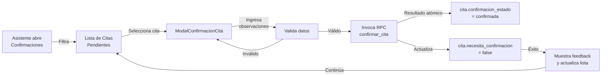
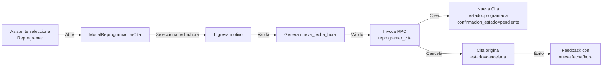
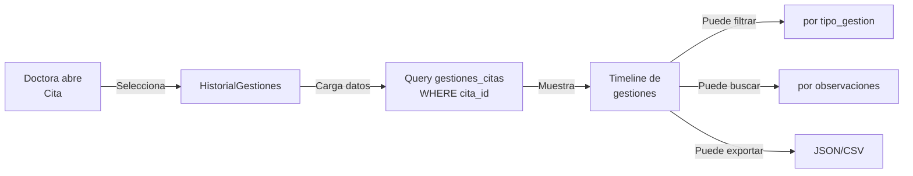

# Design Document

## Overview

Este documento describe la arquitectura técnica, modelo de datos y componentes para implementar el feature "Gestión de Confirmación de Citas Odontológicas" en DentiFlow.

**Objetivo**: Permitir que la asistente identifique citas pendientes de confirmación, registre confirmaciones, cancelaciones y reprogramaciones, y documente el historial completo de gestiones para reducir inasistencias y mejorar la organización de la agenda.

**Stack Tecnológico**: React + TypeScript + Tailwind CSS (Frontend) | Supabase PostgreSQL + RLS (Backend) | Timezone: America/Managua

---

## Architecture

### Stack Tecnológico (Consistente con SPEC-001)

```
┌─────────────────────────────────────────────────────────────┐
│                    FRONTEND (React + TS)                    │
│  ├─ Pages (Confirmaciones, Gestiones, Historial)           │
│  ├─ Components (Modales, Tablas, Alertas, Badges)          │
│  └─ Hooks (useGestiones, useCitasPendientes, etc.)         │
└────────────────────────┬────────────────────────────────────┘
                         │ (HTTPS REST API)
┌────────────────────────▼────────────────────────────────────┐
│            SUPABASE (Backend as a Service)                  │
│  ├─ Supabase Auth (Autenticación Asistente/Doctora)        │
│  ├─ PostgreSQL Database                                     │
│  │  ├─ pacientes (SPEC-001)                                 │
│  │  ├─ citas (SPEC-001, extendida)                          │
│  │  ├─ tratamientos (SPEC-001)                              │
│  │  ├─ gestiones_citas (NUEVA)                              │
│  │  └─ [otras tablas SPEC-001]                              │
│  ├─ RLS Policies (Control de acceso por rol)                │
│  └─ Edge Functions (Lógica del servidor)                    │
└─────────────────────────────────────────────────────────────┘
```

### Flujo de Datos

```
Asistente (Navegador)
    ↓
React Component (ListaCitasPendientes, ModalConfirmacion, etc.)
    ↓
Supabase Client (TypeScript SDK)
    ↓
Supabase API (REST/Real-time)
    ↓
PostgreSQL Database + RLS Policies
    ↓
Datos filtrados por rol (solo Asistente puede crear gestiones)
```

---

## Components and Interfaces

### React Components

#### ListaCitasPendientes
Tabla interactiva que muestra todas las citas pendientes de confirmación con filtros, ordenamiento y acciones rápidas.

**Propósito**: Identificar y priorizar citas que requieren confirmación
**Responsabilidades**: Mostrar tabla de citas, aplicar filtros, desencadenar modales de acción

#### ModalConfirmacionCita
Modal para registrar la confirmación de una cita específica.

**Propósito**: Invocar la RPC de Gestion_de_Cita con tipo='confirmacion'
**Responsabilidades**: Validar observaciones, llamar API, mostrar feedback

#### ModalCancelacionCita
Modal para registrar cancelación de cita con motivo.

**Propósito**: Invocar la RPC de Gestion_de_Cita con tipo='cancelacion'
**Responsabilidades**: Capturar motivo, validar datos, actualizar estado de cita

#### ModalReprogramacionCita
Modal para cambiar fecha/hora de una cita.

**Propósito**: Crear nueva Cita y registrar reprogramación
**Responsabilidades**: Validar fecha futura, crear nueva cita, documentar cambio

#### HistorialGestiones
Componente de timeline que muestra todas las gestiones realizadas en una cita.

**Propósito**: Visualizar historial completo de contactos y acciones
**Responsabilidades**: Mostrar timeline, filtrar por tipo, exportar datos

### Custom Hooks

#### useGestiones
Hook para consultar el historial e invocar las RPC autorizadas. Las gestiones son inmutables.

**Métodos**: confirmarCitaRPC, cancelarCitaRPC, reprogramarCitaRPC, registrarContactoCitaRPC, getHistorialGestiones

#### useCitasPendientes
Hook para obtener y gestionar citas pendientes de confirmación.

**Métodos**: getCitasPendientes, refresh, filtrar, ordenar

### TypeScript Types

```typescript
type UUID = string;
type TIMESTAMPTZ = string; // Instante ISO 8601; se convierte al huso America/Managua solo para presentar.

enum TipoGestion {
  CONTACTO = 'contacto',
  CONFIRMACION = 'confirmacion',
  CANCELACION = 'cancelacion',
  REPROGRAMACION = 'reprogramacion'
}

enum RespuestaPaciente {
  CONFIRMADA = 'confirmada',
  CANCELADA = 'cancelada',
  REPROGRAMADA = 'reprogramada',
  SIN_RESPUESTA = 'sin_respuesta',
  NUMERO_INVALIDO = 'numero_invalido',
  PACIENTE_RECHAZA = 'paciente_rechaza'
}

enum ConfirmacionEstado {
  PENDIENTE = 'pendiente',
  CONFIRMADA = 'confirmada',
  CANCELADA = 'cancelada',
  REPROGRAMADA = 'reprogramada'
}

interface GestionCita {
  id: UUID;
  cita_id: UUID;
  tipo_gestion: TipoGestion;
  respuesta_paciente: RespuestaPaciente;
  motivo?: string;
  observaciones?: string;
  medio_contacto?: string;
  usuario_id: UUID;
  nueva_fecha_hora?: TIMESTAMPTZ;
  nueva_cita_id?: UUID;
  fecha_gestion: TIMESTAMPTZ;
  created_at: TIMESTAMPTZ;
  updated_at: TIMESTAMPTZ;
}

interface CrearGestionDTO {
  cita_id: UUID;
  tipo_gestion: TipoGestion;
  respuesta_paciente: RespuestaPaciente;
  motivo?: string;
  observaciones?: string;
  medio_contacto?: string;
  nueva_fecha_hora?: TIMESTAMPTZ;
}

interface EstadisticasConfirmacion {
  total_citas: number;
  confirmadas: number;
  canceladas: number;
  reprogramadas: number;
  pendientes: number;
  tasa_confirmacion_pct: number;
}
```

---

## Data Models

### Extensiones a Tabla `citas` (SPEC-001)

Esta extensión se aplica **después** de crear la tabla `citas` de SPEC-001. El modelo utiliza `estado` para la situación de agenda y `confirmacion_estado` para la decisión administrativa de confirmación. Los dos atributos no se deben mezclar.

```sql
ALTER TABLE citas
  ADD COLUMN IF NOT EXISTS necesita_confirmacion BOOLEAN NOT NULL DEFAULT true,
  ADD COLUMN IF NOT EXISTS confirmacion_estado TEXT NOT NULL DEFAULT 'pendiente',
  ADD COLUMN IF NOT EXISTS fecha_confirmacion TIMESTAMPTZ,
  ADD COLUMN IF NOT EXISTS fecha_cancelacion TIMESTAMPTZ,
  ADD COLUMN IF NOT EXISTS fecha_reprogramacion TIMESTAMPTZ,
  ADD COLUMN IF NOT EXISTS retry_count INTEGER NOT NULL DEFAULT 0;

ALTER TABLE citas ADD CONSTRAINT citas_confirmacion_estado_check
  CHECK (confirmacion_estado IN ('pendiente', 'confirmada', 'cancelada', 'reprogramada'));
ALTER TABLE citas ADD CONSTRAINT citas_confirmacion_fechas_check CHECK (
  (confirmacion_estado <> 'confirmada' OR fecha_confirmacion IS NOT NULL)
  AND (confirmacion_estado <> 'cancelada' OR fecha_cancelacion IS NOT NULL)
  AND (confirmacion_estado <> 'reprogramada' OR fecha_reprogramacion IS NOT NULL)
  AND (confirmacion_estado = 'confirmada' OR fecha_confirmacion IS NULL)
  AND (confirmacion_estado = 'cancelada' OR fecha_cancelacion IS NULL)
  AND (confirmacion_estado = 'reprogramada' OR fecha_reprogramacion IS NULL)
);
CREATE INDEX IF NOT EXISTS idx_citas_necesita_confirmacion ON citas(necesita_confirmacion);
CREATE INDEX IF NOT EXISTS idx_citas_confirmacion_estado ON citas(confirmacion_estado);
```

**Confirmación anticipada:** `fecha_confirmacion` puede ser anterior a `fecha_hora_inicio`. Una cita confirmada que posteriormente se cancele o reprograme conserva su confirmación histórica en `gestiones_citas`, y se limpia `fecha_confirmacion` al cambiar su estado actual.

### Nueva Tabla: `gestiones_citas`

```sql
CREATE TABLE gestiones_citas (
  id UUID PRIMARY KEY DEFAULT gen_random_uuid(),
  
  -- Relación con cita
  cita_id UUID NOT NULL REFERENCES citas(id) ON DELETE RESTRICT,
  
  -- Tipo de gestión
  tipo_gestion TEXT NOT NULL 
    CONSTRAINT gestiones_citas_tipo_check 
    CHECK (tipo_gestion IN ('contacto', 'confirmacion', 'cancelacion', 'reprogramacion')),
  
  -- Respuesta del paciente
  respuesta_paciente TEXT NOT NULL 
    CONSTRAINT gestiones_citas_respuesta_check 
    CHECK (respuesta_paciente IN (
      'confirmada', 'cancelada', 'reprogramada', 'sin_respuesta', 
      'numero_invalido', 'paciente_rechaza'
    )),
  
  -- Detalles de la gestión
  motivo TEXT,
  observaciones TEXT,
  medio_contacto TEXT CHECK (medio_contacto IS NULL OR medio_contacto IN
    ('telefono','presencial','correo','otro','whatsapp_manual')),
  CONSTRAINT gestiones_tipo_respuesta_compatible CHECK (
    (tipo_gestion = 'contacto' AND respuesta_paciente IN
      ('sin_respuesta','numero_invalido','paciente_rechaza')) OR
    (tipo_gestion = 'confirmacion' AND respuesta_paciente = 'confirmada') OR
    (tipo_gestion = 'cancelacion' AND respuesta_paciente = 'cancelada') OR
    (tipo_gestion = 'reprogramacion' AND respuesta_paciente = 'reprogramada')
  ),
  usuario_id UUID NOT NULL REFERENCES auth.users(id) ON DELETE RESTRICT,
  
  -- Para reprogramaciones
  nueva_fecha_hora TIMESTAMPTZ,
  nueva_cita_id UUID REFERENCES citas(id) ON DELETE SET NULL,
  
  -- Auditoría
  fecha_gestion TIMESTAMPTZ DEFAULT NOW(),
  created_at TIMESTAMPTZ DEFAULT NOW(),
  updated_at TIMESTAMPTZ DEFAULT NOW()
);

-- Índices
CREATE INDEX IF NOT EXISTS idx_gestiones_citas_cita_id ON gestiones_citas(cita_id);
CREATE INDEX IF NOT EXISTS idx_gestiones_citas_tipo_gestion ON gestiones_citas(tipo_gestion);
CREATE INDEX IF NOT EXISTS idx_gestiones_citas_usuario_id ON gestiones_citas(usuario_id);
CREATE INDEX IF NOT EXISTS idx_gestiones_citas_respuesta ON gestiones_citas(respuesta_paciente);
CREATE INDEX IF NOT EXISTS idx_gestiones_citas_fecha ON gestiones_citas(fecha_gestion);
```

### Validación de transiciones de estado

La restricción `CHECK` verifica los **valores** permitidos, no la secuencia histórica. El siguiente trigger establece las transiciones. Se permite cancelar o reprogramar una cita confirmada (con registro de auditoría); los estados `cancelada` y `reprogramada` son terminales para la cita original.

```sql
CREATE OR REPLACE FUNCTION validar_transicion_confirmacion()
RETURNS TRIGGER LANGUAGE plpgsql AS $$
BEGIN
  IF NEW.confirmacion_estado IS DISTINCT FROM OLD.confirmacion_estado THEN
    IF OLD.confirmacion_estado NOT IN ('pendiente', 'confirmada')
       OR NEW.confirmacion_estado NOT IN ('confirmada', 'cancelada', 'reprogramada')
       OR (OLD.confirmacion_estado = 'confirmada' AND NEW.confirmacion_estado = 'confirmada')
    THEN
      RAISE EXCEPTION 'Transición de confirmación no permitida: % a %',
        OLD.confirmacion_estado, NEW.confirmacion_estado;
    END IF;
  END IF;
  RETURN NEW;
END;
$$;

CREATE TRIGGER trigger_validar_transicion_confirmacion
BEFORE UPDATE OF confirmacion_estado ON citas
FOR EACH ROW EXECUTE FUNCTION validar_transicion_confirmacion();
```

Las modificaciones de `citas.estado`, `confirmacion_estado` y fechas asociadas deben ser consistentes y, cuando involucran reprogramación, efectuarse mediante una **única función transaccional**. No interpretar un `CHECK` como historial de transiciones.

### Relaciones de datos y reprogramación

- `pacientes.id` → `citas.paciente_id` (uno a muchos).
- `citas.id` → `gestiones_citas.cita_id` (uno a muchos).
- `citas.id` → `sesiones_tratamientos.cita_id` (uno a muchos; la clave foránea está en **sesiones_tratamientos**).
- `tratamientos.id` → `sesiones_tratamientos.tratamiento_id` (uno a muchos).
- **No existen** columnas `tratamiento_id` ni `sesion_id` en la tabla `citas`.

Al reprogramar, se crea una nueva cita, la anterior pasa a `cancelada` / `reprogramada`, y solo las sesiones **no completadas** vinculadas a la cita anterior se reasignan a la nueva mediante `sesiones_tratamientos.cita_id`. Las sesiones completadas conservan su trazabilidad histórica.

## Queries Principales

### Q1: Obtener Citas Pendientes de Confirmación

```sql
SELECT 
  c.id, c.paciente_id, c.fecha_hora_inicio, c.estado,
  c.necesita_confirmacion, c.confirmacion_estado, c.retry_count,
  p.nombre_completo, p.telefono, p.telefono_whatsapp,
  COUNT(g.id) as intentos_contacto
FROM citas c
JOIN pacientes p ON c.paciente_id = p.id
LEFT JOIN gestiones_citas g ON c.id = g.cita_id
WHERE c.necesita_confirmacion = true
  AND c.confirmacion_estado = 'pendiente'
  AND c.estado = 'programada'
  AND c.fecha_hora_inicio > NOW()
GROUP BY c.id, p.id
ORDER BY 
  CASE 
    WHEN c.fecha_hora_inicio <= NOW() + INTERVAL '48 hours' THEN 0
    ELSE 1
  END,
  c.fecha_hora_inicio ASC;
```

### Q2: Obtener Historial de Gestiones por Cita

La consulta usa `public.usuarios`, una tabla de perfiles de aplicación protegida por RLS, vinculada a `auth.users(id)`. **SPEC-001 debe crearla y protegerla con RLS antes de ejecutar Q2**; no exponer `auth.users` mediante consultas directas del navegador. El perfil solo debe contener datos administrativos necesarios.

```sql
SELECT 
  g.id, g.tipo_gestion, g.respuesta_paciente, 
  g.fecha_gestion, g.motivo, g.observaciones,
  u.nombre_completo as usuario_nombre,
  g.nueva_fecha_hora
FROM gestiones_citas g
LEFT JOIN public.usuarios u ON g.usuario_id = u.id
WHERE g.cita_id = $1
ORDER BY g.fecha_gestion DESC;
```

### Q3: Estadísticas de Confirmación (por rango de fechas)

```sql
SELECT 
  COUNT(DISTINCT c.id) as total_citas,
  COUNT(DISTINCT CASE WHEN c.confirmacion_estado = 'confirmada' THEN c.id END) as confirmadas,
  COUNT(DISTINCT CASE WHEN c.confirmacion_estado = 'cancelada' THEN c.id END) as canceladas,
  COUNT(DISTINCT CASE WHEN c.confirmacion_estado = 'reprogramada' THEN c.id END) as reprogramadas,
  COUNT(DISTINCT CASE WHEN c.confirmacion_estado = 'pendiente' THEN c.id END) as pendientes,
  ROUND(
    100.0 * COUNT(DISTINCT CASE WHEN c.confirmacion_estado = 'confirmada' THEN c.id END) / 
    NULLIF(COUNT(DISTINCT c.id), 0), 2
  ) as tasa_confirmacion_pct
FROM citas c
WHERE c.fecha_hora_inicio BETWEEN $1 AND $2;
```

### Q4: Motivos de Cancelación (estadísticas)

```sql
SELECT 
  g.motivo,
  COUNT(*) as frecuencia,
  ROUND(100.0 * COUNT(*) / NULLIF((SELECT COUNT(*) FROM gestiones_citas WHERE tipo_gestion = 'cancelacion' AND respuesta_paciente = 'cancelada' AND fecha_gestion BETWEEN $1 AND $2), 0), 2) as porcentaje
FROM gestiones_citas g
WHERE g.tipo_gestion = 'cancelacion' 
  AND g.respuesta_paciente = 'cancelada'
  AND g.fecha_gestion BETWEEN $1 AND $2
GROUP BY g.motivo
ORDER BY frecuencia DESC;
```

### Q5: Citas con Múltiples Intentos Fallidos

```sql
SELECT 
  c.id, c.paciente_id, p.nombre_completo, p.telefono, p.telefono_whatsapp,
  c.fecha_hora_inicio, c.retry_count,
  COUNT(g.id) as total_gestiones,
  STRING_AGG(g.respuesta_paciente, ', ' ORDER BY g.fecha_gestion DESC) as historial_respuestas
FROM citas c
JOIN pacientes p ON c.paciente_id = p.id
LEFT JOIN gestiones_citas g ON c.id = g.cita_id
WHERE c.retry_count >= 2 
  AND c.necesita_confirmacion = true
  AND c.estado = 'programada'
GROUP BY c.id, p.id
ORDER BY c.retry_count DESC, c.fecha_hora_inicio ASC;
```

---

## Componentes React

### 1. ListaCitasPendientes

**Propósito**: Mostrar tabla de citas pendientes de confirmación con filtros y acciones rápidas

**Props**:
```typescript
interface ListaCitasPendientesProps {
  filtro?: 'todas' | 'proximas_48h' | 'confirmadas' | 'canceladas';
  ordenar?: 'fecha_asc' | 'fecha_desc' | 'reintentos';
  onSelectCita: (citaId: UUID) => void;
  onRefresh: () => void;
}
```

**Features**:
- Tabla interactiva con paginación (20 registros por página)
- Badge visual para: "Pendiente", "Confirmada", "Cancelada", "Reprogramada"
- Ícono de advertencia para citas con ≥2 intentos fallidos
- Botones de acción rápida: Confirmar, Cancelar, Reprogramar
- Contador de citas pendientes en header
- Filtro por estado de confirmación
- Ordenamiento por fecha o intentos de contacto

**Data Flow**:
```
useEffect(() => {
  fetchCitasPendientes(filtro, ordenar)
    .then(data => setCitas(data))
})
```

---

### 2. ModalConfirmacionCita

**Propósito**: Registrar confirmación de una cita específica

**Props**:
```typescript
interface ModalConfirmacionCitaProps {
  cita: Cita;
  onConfirm: (gestion: CrearGestionDTO) => Promise<void>;
  onClose: () => void;
  isLoading?: boolean;
}
```

**Features**:
- Muestra información del paciente (nombre, teléfono, WhatsApp)
- Muestra fecha y hora de la cita
- Campo de observaciones (e.g., "confirmado vía llamada a las 3pm")
- Botón "Confirmar" que crea Gestion_de_Cita
- Botón "Cancelar" que cierra el modal
- Validación: observaciones mínimo 10 caracteres (opcional)
- Feedback de éxito: "Cita confirmada" con timestamp

**On Submit**:
```typescript
{
  tipo_gestion: 'confirmacion',
  respuesta_paciente: 'confirmada',
  observaciones: string,
  cita_id: UUID
}
```

---

### 3. ModalCancelacionCita

**Propósito**: Registrar cancelación de una cita con motivo

**Props**:
```typescript
interface ModalCancelacionCitaProps {
  cita: Cita;
  onCancel: (gestion: CrearGestionDTO) => Promise<void>;
  onClose: () => void;
  isLoading?: boolean;
}
```

**Features**:
- Muestra información de la cita (paciente, fecha, hora)
- Dropdown para seleccionar motivo: "Paciente enfermo", "Emergencia", "Cambio de planes", "Otros"
- Campo de observaciones adicionales (opcional)
- Checkbox de confirmación: "¿Está seguro de que desea cancelar?"
- Botón "Cancelar Cita" que crea Gestion_de_Cita con tipo 'cancelacion'
- Feedback: "Cita cancelada" y opción de "Ver citas disponibles"

**On Submit**:
```typescript
{
  tipo_gestion: 'cancelacion',
  respuesta_paciente: 'cancelada',
  motivo: string,
  observaciones?: string,
  cita_id: UUID
}
```

---

### 4. ModalReprogramacionCita

**Propósito**: Cambiar fecha/hora de una cita existente

**Props**:
```typescript
interface ModalReprogramacionCitaProps {
  cita: Cita;
  onReschedule: (nuevaFecha: TIMESTAMPTZ, motivo: string) => Promise<void>;
  onClose: () => void;
  isLoading?: boolean;
  citasDisponibles?: Cita[];
}
```

**Features**:
- Muestra información de la cita original (fecha, hora actual)
- Picker de fecha: Mínimo futuro, máximo 30 días después
- Picker de hora: Horario de consultorio (e.g., 9am-6pm en bloques de 30min)
- Valida que nueva_fecha_hora no sea en el pasado
- Campo de motivo: "Paciente no puede asistir", "Conflicto de agenda", "Solicitud del paciente", "Otros"
- Opción de ver "Próximos horarios disponibles"
- Botón "Reprogramar" que crea nueva Cita y Gestion_de_Cita
- Feedback: "Cita reprogramada a [fecha/hora]"

**On Submit** (operación única mediante RPC):
1. Marcar la cita original como reprogramada/cancelada en agenda.
2. Crear la nueva cita pendiente de confirmación.
3. Trasladar las sesiones no completadas vinculadas.
4. Registrar **una sola gestión histórica de reprogramación**, vinculando ambas citas.

#### Lógica de reprogramación (AC 5.2a–5.2e)

La reprogramación debe ser **atómica**, preservar las asociaciones con sesiones y no permitir que el frontend inserte directamente nuevas citas o cambie estados por separado. La llamada se realiza mediante una función RPC de PostgreSQL invocada por un usuario autenticado. La función utiliza el ID autenticado `auth.uid()`, no un `usuario_id` enviado por el cliente.

**Reglas:** la nueva fecha debe ser futura y dentro de los próximos 30 días; la duración se conserva; no puede solaparse con otras citas activas del paciente; solo se pueden reprogramar citas futuras programadas que no hayan sido previamente canceladas o reprogramadas. Las sesiones completadas no se trasladan. El backend debe validar además el horario de atención configurable del consultorio antes de habilitar el cambio; no existe todavía una tabla de horarios en SPEC-001, por lo que este último requisito queda como validación de aplicación y no se presenta falsamente como un constraint SQL.

**Función SQL de referencia (para validación y adaptación en Supabase):**

```sql
CREATE OR REPLACE FUNCTION public.reprogramar_cita(
  p_cita_original_id UUID,
  p_nueva_fecha_hora TIMESTAMPTZ,
  p_motivo TEXT DEFAULT NULL,
  p_observaciones TEXT DEFAULT NULL
)
RETURNS UUID
LANGUAGE plpgsql
SECURITY DEFINER
SET search_path = ''
AS $$
DECLARE
  v_original public.citas%ROWTYPE;
  v_nueva_cita_id UUID;
  v_duracion INTERVAL;
  v_nuevo_fin TIMESTAMPTZ;

BEGIN
  IF auth.uid() IS NULL OR (auth.jwt() -> 'app_metadata' ->> 'rol') IS DISTINCT FROM 'asistente' THEN
    RAISE EXCEPTION 'Sin autorización para reprogramar';
  END IF;

  SELECT * INTO v_original
  FROM public.citas
  WHERE id = p_cita_original_id
  FOR UPDATE;

  IF NOT FOUND OR v_original.estado <> 'programada'
     OR v_original.confirmacion_estado NOT IN ('pendiente', 'confirmada') THEN
    RAISE EXCEPTION 'La cita no existe o no puede reprogramarse';
  END IF;

  IF v_original.fecha_hora_inicio <= NOW() THEN
    RAISE EXCEPTION 'No se puede reprogramar una cita pasada';
  END IF;

  IF nullif(btrim(p_motivo), '') IS NULL THEN
    RAISE EXCEPTION 'El motivo de reprogramación es obligatorio';
  END IF;

  IF p_nueva_fecha_hora IS NULL
     OR p_nueva_fecha_hora <= NOW()
     OR p_nueva_fecha_hora > NOW() + INTERVAL '30 days' THEN
    RAISE EXCEPTION 'Nueva fecha fuera del rango permitido';
  END IF;

  v_duracion := COALESCE(
    v_original.fecha_hora_fin - v_original.fecha_hora_inicio,
    make_interval(mins => COALESCE(v_original.duracion_minutos, 60))
  );
  IF v_duracion <= INTERVAL '0 seconds' THEN
    RAISE EXCEPTION 'La duración de la cita es inválida';
  END IF;
  v_nuevo_fin := p_nueva_fecha_hora + v_duracion;

  IF EXISTS (
    SELECT 1 FROM public.citas c
    WHERE c.paciente_id = v_original.paciente_id
      AND c.id <> v_original.id
      AND c.estado IN ('programada','completada','no_asistio')
      AND tstzrange(c.fecha_hora_inicio,
            COALESCE(c.fecha_hora_fin, c.fecha_hora_inicio +
              make_interval(mins => COALESCE(c.duracion_minutos, 60))), '[)')
          && tstzrange(p_nueva_fecha_hora, v_nuevo_fin, '[)')
  ) THEN
    RAISE EXCEPTION 'La nueva cita se solapa con otra cita del paciente';
  END IF;

  -- Primero liberar la franja de la cita anterior. Si cualquier paso posterior
  -- falla, PostgreSQL revierte todos los cambios de esta llamada RPC.
  UPDATE public.citas
  SET estado = 'cancelada',
      confirmacion_estado = 'reprogramada',
      fecha_confirmacion = NULL,
      fecha_cancelacion = NULL,
      fecha_reprogramacion = NOW(),
      necesita_confirmacion = false,
      updated_at = NOW()
  WHERE id = v_original.id;

  INSERT INTO public.citas (
    paciente_id, fecha_hora_inicio, fecha_hora_fin, duracion_minutos,
    estado, motivo, observaciones_administrativas,
    necesita_confirmacion, confirmacion_estado, retry_count
  ) VALUES (
    v_original.paciente_id, p_nueva_fecha_hora, v_nuevo_fin,
    COALESCE(v_original.duracion_minutos, EXTRACT(EPOCH FROM v_duracion)::INTEGER / 60),
    'programada', v_original.motivo, v_original.observaciones_administrativas,
    true, 'pendiente', 0
  ) RETURNING id INTO v_nueva_cita_id;

  UPDATE public.sesiones_tratamientos
  SET cita_id = v_nueva_cita_id,
      fecha_programada = (p_nueva_fecha_hora AT TIME ZONE 'America/Managua')::date
  WHERE cita_id = v_original.id
    AND estado IN ('pendiente','reprogramada');


  INSERT INTO public.gestiones_citas (
    cita_id, tipo_gestion, respuesta_paciente, motivo, observaciones,
    usuario_id, nueva_fecha_hora, nueva_cita_id
  ) VALUES (
    v_original.id, 'reprogramacion', 'reprogramada', p_motivo,
    p_observaciones, auth.uid(), p_nueva_fecha_hora, v_nueva_cita_id
  );

  RETURN v_nueva_cita_id;
END;
$$;

REVOKE ALL ON FUNCTION public.reprogramar_cita(UUID, TIMESTAMPTZ, TEXT, TEXT) FROM PUBLIC;
GRANT EXECUTE ON FUNCTION public.reprogramar_cita(UUID, TIMESTAMPTZ, TEXT, TEXT) TO authenticated;
```

**Seguridad y concurrencia:** la función es `SECURITY DEFINER` de propietario privilegiado y valida explícitamente el rol desde `app_metadata`. Bloquea la fila original con `FOR UPDATE` y depende **obligatoriamente** de `citas_sin_solapamiento_paciente` definida en SPEC-001. La restricción `EXCLUDE USING gist` es el control definitivo frente a reservas solapadas simultáneas; el `EXISTS` aporta un mensaje anticipado, pero no sustituye la restricción. La reprogramación ocurre dentro de una sola transacción de la RPC y guarda **una** gestión histórica por operación. Probar dos peticiones simultáneas antes de producción.

**Contrato de frontend (TypeScript conceptual):** usar `supabase.rpc('reprogramar_cita', {p_cita_original_id, p_nueva_fecha_hora, p_motivo, p_observaciones})`; mostrar éxito solo si la RPC devuelve la nueva cita, y refrescar agenda y bandeja. No ejecutar múltiples operaciones CRUD separadas desde el navegador.

### 5. HistorialGestiones

**Propósito**: Mostrar el historial completo de gestiones (confirmaciones, cancelaciones, reprogramaciones) de una cita

**Props**:
```typescript
interface HistorialGestionesProps {
  citaId: UUID;
  modo?: 'compacto' | 'detallado';
  onRefresh?: () => void;
}
```

**Features**:
- Timeline vertical mostrando todas las gestiones (más recientes arriba)
- Para cada gestión: fecha/hora, tipo (ícono + color), respuesta, usuario, observaciones
- Colores por tipo: Verde (confirmada), Rojo (cancelada), Amarillo (reprogramada), Gris (sin_respuesta)
- Estadísticas: Total intentos, Confirmada sí/no, Última acción
- Modo compacto: Solo últimas 3 gestiones
- Modo detallado: Todas las gestiones con búsqueda y filtros
- Filtro por tipo_gestion
- Búsqueda por observaciones
- Botón "Exportar historial" (descarga JSON/CSV)

**Data**:
```typescript
interface GestionCitaUI {
  id: UUID;
  tipo_gestion: 'confirmacion' | 'cancelacion' | 'reprogramacion';
  respuesta_paciente: string;
  fecha_gestion: TIMESTAMPTZ;
  usuario_nombre: string;
  motivo?: string;
  observaciones?: string;
  medio_contacto?: string;
  nueva_fecha_hora?: TIMESTAMPTZ;
}
```

---

## RLS y operaciones transaccionales canónicas

**Regla única:** `gestiones_citas` es historial **append-only**. El navegador únicamente consulta. No puede insertar, modificar ni borrar gestiones; tampoco modificar directamente los campos de estado, confirmación y fechas de `citas`. Las gestiones y los cambios de citas se producen desde funciones transaccionales con `SECURITY DEFINER` de propietario privilegiado, que validan `auth.uid()` y el claim protegido `app_metadata.rol`. Los roles se aprovisionan exclusivamente desde backend administrativo. No exponer `service_role` ni permitir que el cliente envíe `usuario_id`.

```sql
ALTER TABLE public.gestiones_citas ENABLE ROW LEVEL SECURITY;
DROP POLICY IF EXISTS asistente_gestiones_citas_select ON public.gestiones_citas;
DROP POLICY IF EXISTS doctora_gestiones_citas_select ON public.gestiones_citas;
DROP POLICY IF EXISTS asistente_gestiones_citas_insert ON public.gestiones_citas;
DROP POLICY IF EXISTS asistente_gestiones_citas_update_own ON public.gestiones_citas;
CREATE POLICY gestiones_citas_lectura_personal ON public.gestiones_citas
  FOR SELECT TO authenticated
  USING ((auth.jwt() -> 'app_metadata' ->> 'rol') IN ('asistente','doctora'));
-- Sin políticas INSERT/UPDATE/DELETE para usuarios de la aplicación.
REVOKE INSERT, UPDATE, DELETE ON public.gestiones_citas FROM authenticated, anon;
-- En SPEC-002 los cambios de agenda y confirmaciones deben pasar por RPC.
REVOKE UPDATE ON public.citas FROM authenticated, anon;
GRANT UPDATE (motivo, observaciones_administrativas) ON public.citas TO authenticated;
-- Reforzar que nuevas citas nazcan pendientes, mediante la política INSERT:
DROP POLICY IF EXISTS citas_insert_asistente ON public.citas;
CREATE POLICY citas_insert_asistente ON public.citas
  FOR INSERT TO authenticated WITH CHECK (
    auth.jwt() -> 'app_metadata' ->> 'rol' = 'asistente'
    AND estado = 'programada'
    AND confirmacion_estado = 'pendiente'
    AND necesita_confirmacion = true
    AND fecha_confirmacion IS NULL AND fecha_cancelacion IS NULL
    AND fecha_reprogramacion IS NULL
  );
```

**Importante:** este cambio de permisos se aplica **después** de SPEC-001; puede requerir ajustar concesiones existentes en Supabase antes de publicar. Una función `SECURITY DEFINER` solo es segura con propietario administrativo de confianza, `SET search_path = ''`, uso de nombres `public.` explícitos, validación interna de roles, parámetros y permisos de ejecución mínimos. El despliegue y las pruebas de acceso deben ejecutarse con usuarios reales en Supabase.

### Funciones transaccionales obligatorias

Las funciones siguientes constituyen el **contrato de persistencia** para confirmación, cancelación y contactos fallidos. En todos los casos, el cambio de estado y el registro histórico deben ser una sola transacción; si una sentencia falla se revierte la operación completa. La función de reprogramación definida arriba sigue el mismo contrato.

```sql
CREATE OR REPLACE FUNCTION public.confirmar_cita(p_cita_id uuid, p_observaciones text DEFAULT NULL)
RETURNS uuid LANGUAGE plpgsql SECURITY DEFINER SET search_path = '' AS $$
DECLARE v_cita public.citas%ROWTYPE; v_gestion uuid;
BEGIN
  IF auth.uid() IS NULL OR (auth.jwt() -> 'app_metadata' ->> 'rol') IS DISTINCT FROM 'asistente' THEN
    RAISE EXCEPTION 'Sin autorización';
  END IF;
  SELECT * INTO v_cita FROM public.citas WHERE id = p_cita_id FOR UPDATE;
  IF NOT FOUND OR v_cita.estado <> 'programada'
     OR v_cita.confirmacion_estado <> 'pendiente' OR v_cita.fecha_hora_inicio <= now() THEN
    RAISE EXCEPTION 'La cita no está pendiente o ya venció';
  END IF;
  UPDATE public.citas
  SET confirmacion_estado = 'confirmada', necesita_confirmacion = false,
      fecha_confirmacion = now(), fecha_cancelacion = NULL, fecha_reprogramacion = NULL
  WHERE id = p_cita_id;
  INSERT INTO public.gestiones_citas(cita_id, tipo_gestion, respuesta_paciente,
    usuario_id, observaciones)
  VALUES(p_cita_id, 'confirmacion', 'confirmada', auth.uid(), p_observaciones)
  RETURNING id INTO v_gestion;
  RETURN v_gestion;
END;
$$;

CREATE OR REPLACE FUNCTION public.cancelar_cita(p_cita_id uuid, p_motivo text,
  p_observaciones text DEFAULT NULL)
RETURNS uuid LANGUAGE plpgsql SECURITY DEFINER SET search_path = '' AS $$
DECLARE v_cita public.citas%ROWTYPE; v_gestion uuid;
BEGIN
  IF auth.uid() IS NULL OR (auth.jwt() -> 'app_metadata' ->> 'rol') IS DISTINCT FROM 'asistente' THEN
    RAISE EXCEPTION 'Sin autorización';
  END IF;
  IF nullif(btrim(p_motivo), '') IS NULL THEN RAISE EXCEPTION 'El motivo es obligatorio'; END IF;
  SELECT * INTO v_cita FROM public.citas WHERE id = p_cita_id FOR UPDATE;
  IF NOT FOUND OR v_cita.estado <> 'programada'
     OR v_cita.confirmacion_estado NOT IN ('pendiente','confirmada') THEN
    RAISE EXCEPTION 'La cita no puede cancelarse';
  END IF;
  UPDATE public.citas
  SET estado = 'cancelada', confirmacion_estado = 'cancelada',
      necesita_confirmacion = false, fecha_cancelacion = now(),
      fecha_confirmacion = NULL, fecha_reprogramacion = NULL
  WHERE id = p_cita_id;
  INSERT INTO public.gestiones_citas(cita_id, tipo_gestion, respuesta_paciente,
    usuario_id, motivo, observaciones)
  VALUES(p_cita_id, 'cancelacion', 'cancelada', auth.uid(), p_motivo, p_observaciones)
  RETURNING id INTO v_gestion;
  RETURN v_gestion;
END;
$$;

CREATE OR REPLACE FUNCTION public.registrar_contacto_cita(p_cita_id uuid,
  p_respuesta text, p_observaciones text DEFAULT NULL,
  p_medio_contacto text DEFAULT 'telefono')
RETURNS uuid LANGUAGE plpgsql SECURITY DEFINER SET search_path = '' AS $$
DECLARE v_gestion uuid; v_cita public.citas%ROWTYPE;
BEGIN
  IF auth.uid() IS NULL OR (auth.jwt() -> 'app_metadata' ->> 'rol') IS DISTINCT FROM 'asistente' THEN
    RAISE EXCEPTION 'Sin autorización';
  END IF;
  IF p_respuesta NOT IN ('sin_respuesta','numero_invalido','paciente_rechaza')
     OR p_respuesta IS NULL THEN
    RAISE EXCEPTION 'Resultado de contacto no permitido';
  END IF;
  IF p_medio_contacto IS NULL OR p_medio_contacto NOT IN
      ('telefono','presencial','correo','otro','whatsapp_manual') THEN
    RAISE EXCEPTION 'Medio de contacto inválido';
  END IF;
  SELECT * INTO v_cita FROM public.citas WHERE id = p_cita_id FOR UPDATE;
  IF NOT FOUND OR v_cita.estado <> 'programada' OR v_cita.confirmacion_estado <> 'pendiente' THEN
    RAISE EXCEPTION 'La cita no admite nuevos intentos de contacto';
  END IF;
  INSERT INTO public.gestiones_citas(cita_id, tipo_gestion, respuesta_paciente,
    usuario_id, observaciones, medio_contacto)
  VALUES(p_cita_id, 'contacto', p_respuesta, auth.uid(), p_observaciones, p_medio_contacto)
  RETURNING id INTO v_gestion;
  UPDATE public.citas SET retry_count = retry_count + 1 WHERE id = p_cita_id;
  RETURN v_gestion;
END;
$$;

REVOKE ALL ON FUNCTION public.confirmar_cita(uuid,text) FROM PUBLIC;
REVOKE ALL ON FUNCTION public.cancelar_cita(uuid,text,text) FROM PUBLIC;
REVOKE ALL ON FUNCTION public.registrar_contacto_cita(uuid,text,text,text) FROM PUBLIC;
GRANT EXECUTE ON FUNCTION public.confirmar_cita(uuid,text) TO authenticated;
GRANT EXECUTE ON FUNCTION public.cancelar_cita(uuid,text,text) TO authenticated;
GRANT EXECUTE ON FUNCTION public.registrar_contacto_cita(uuid,text,text,text) TO authenticated;
```

El frontend invoca exclusivamente estas RPC y `reprogramar_cita`, nunca un `INSERT` directo a `gestiones_citas` ni un `UPDATE` directo de estados en `citas`. Los usuarios sin rol y la doctora no tienen permisos de escritura. **La unicidad de auditoría se verifica en las pruebas**, que incluyen rollback tras fallo inducido y dos peticiones concurrentes.

### Matriz de permisos

| Acción | Asistente | Doctora | Sin rol/Anónimo |
|---|---|---|---|
| Consultar citas y gestiones | Sí | Sí | No |
| Crear cita pendiente | Sí | No | No |
| Confirmar/cancelar/reprogramar vía RPC | Sí | No | No |
| Registrar intento de contacto vía RPC | Sí | No | No |
| INSERT/UPDATE/DELETE directos en gestiones | No | No | No |
| UPDATE directo de estado, confirmación y fechas en citas | No | No | No |


### 3.5 Índices de Performance (Compound Indices)

Para garantizar performance óptima en consultas frecuentes, se implementan los siguientes índices compuestos (multi-column) en las tablas:

#### Índice 1: Gestiones por Cita ordenadas por Fecha (DESC)

**Tabla**: gestiones_citas  
**Columnas**: cita_id, fecha_gestion DESC  
**Propósito**: Query Q2 - Obtener historial de gestiones de una cita ordenado por fecha más reciente

```sql
CREATE INDEX IF NOT EXISTS idx_gestiones_citas_cita_fecha_desc
ON gestiones_citas(cita_id, fecha_gestion DESC)
; -- Sin filtro: la tabla no tiene deleted_at
```
**Esperado**: Query completa sin table scan, <300ms incluso con 10K+ gestiones

**Estadísticas**:
- Tamaño estimado: 2-5 MB para 100K gestiones
- Selectividad: Alta (cita_id es muy selectivo)

---

#### Índice 2: Citas Pendientes de Confirmación (Filtro + Orden)

**Tabla**: citas  
**Columnas**: necesita_confirmacion, fecha_hora_inicio ASC  
**Propósito**: Query Q1 - Obtener citas pendientes de confirmación priorizadas por fecha

```sql
CREATE INDEX IF NOT EXISTS idx_citas_pendientes_por_fecha
ON citas(necesita_confirmacion, fecha_hora_inicio ASC)
WHERE estado = 'programada' AND confirmacion_estado = 'pendiente';
```
**Esperado**: Query Q1 completa (<500ms) sin full table scan

**Estadísticas**:
- Tamaño estimado: 1-3 MB para 10K citas
- Selectividad: Alta (necesita_confirmacion = true es ~5-10% de citas)

---

#### Índice 3: Gestiones por Tipo y Respuesta (Filtro Estadísticas)

**Tabla**: gestiones_citas  
**Columnas**: tipo_gestion, respuesta_paciente, fecha_gestion DESC  
**Propósito**: Queries Q3, Q4 - Estadísticas de confirmación y análisis de motivos

```sql
CREATE INDEX IF NOT EXISTS idx_gestiones_citas_tipo_respuesta_fecha
ON gestiones_citas(tipo_gestion, respuesta_paciente, fecha_gestion DESC)
; -- Sin filtro: la tabla no tiene deleted_at
```
**Esperado**: Queries de estadísticas (<1000ms) incluso sin WHERE fecha

**Estadísticas**:
- Tamaño estimado: 5-8 MB para 100K gestiones
- Selectividad: Media (tipo_gestion tiene 3 valores, respuesta 6)

---

#### Índice 4: Citas por Paciente y Confirmación (Reprogramación + Auditoría)

**Tabla**: citas  
**Columnas**: paciente_id, confirmacion_estado, fecha_hora_inicio DESC  
**Propósito**: Validación de conflictos en reprogramación, auditoria por paciente

```sql
CREATE INDEX IF NOT EXISTS idx_citas_paciente_estado_fecha
ON citas(paciente_id, confirmacion_estado, fecha_hora_inicio DESC)
WHERE estado IN ('programada', 'completada');
```
**Esperado**: Validación de conflictos (<200ms), auditoría de pacientes (<500ms)

**Estadísticas**:
- Tamaño estimado: 3-6 MB para 10K citas
- Selectividad: Alta (paciente_id es muy selectivo)

---

#### Verificación de Índices

```sql
-- Listar todos los índices creados
SELECT 
  schemaname,
  tablename,
  indexname,
  indexdef
FROM pg_indexes
WHERE schemaname = 'public' 
  AND tablename IN ('citas', 'gestiones_citas')
ORDER BY tablename, indexname;

-- Verificar tamaño de índices
SELECT 
  indexrelname,
  pg_size_pretty(pg_relation_size(indexrelid)) AS index_size
FROM pg_stat_user_indexes
WHERE schemaname = 'public'
  AND tablename IN ('citas', 'gestiones_citas');

-- Verificar uso de índices (en Supabase, ejecutar después de carga de prueba)
SELECT 
  schemaname,
  tablename,
  indexrelname,
  idx_scan,
  idx_tup_read,
  idx_tup_fetch
FROM pg_stat_user_indexes
WHERE schemaname = 'public'
  AND tablename IN ('citas', 'gestiones_citas')
ORDER BY idx_scan DESC;
```
---

#### Mantenimiento de Índices

```sql
-- Reindexar periódicamente (una vez por semana en producción)
REINDEX INDEX CONCURRENTLY idx_gestiones_citas_cita_fecha_desc;
REINDEX INDEX CONCURRENTLY idx_citas_pendientes_por_fecha;
REINDEX INDEX CONCURRENTLY idx_gestiones_citas_tipo_respuesta_fecha;
REINDEX INDEX CONCURRENTLY idx_citas_paciente_estado_fecha;

-- Analizar tabla para actualizar estadísticas de query planner
ANALYZE citas;
ANALYZE gestiones_citas;
```
---

## User Flows

### Flow 1: Confirmación de Cita



### Flow 2: Cancelación de Cita

```mermaid
graph LR
    A["Asistente selecciona<br/>Cancelar"] -->|Abre| B["ModalCancelacionCita"]
    B -->|Selecciona motivo| C["Ingresa observaciones"]
    C -->|Confirma| D["Valida motivación"]
    D -->|Válido| E["Invoca RPC<br/>cancelar_cita"]
    E -->|Actualiza| F["cita.estado<br/>= cancelada"]
    F -->|Actualiza| G["cita.confirmacion_estado<br/>= cancelada"]
    G -->|Éxito| H["Feedback y quita<br/>de lista"]
```



### Flow 3: Reprogramación de Cita



### Flow 4: Consulta de Historial



---

## Correctness Properties

*A property is a characteristic or behavior that should hold true across all valid executions of a system—essentially, a formal statement about what the system should do. Properties serve as the bridge between human-readable specifications and machine-verifiable correctness guarantees.*

### Property 1: Confirmación Actualiza Estado

**Para cualquier** Cita que recibe una Gestion_de_Cita con tipo_gestion='confirmacion' y respuesta_paciente='confirmada', el campo confirmacion_estado de esa Cita debe cambiar a 'confirmada' y necesita_confirmacion debe cambiar a false.

**Validates: Requirements 3.1, 3.2, 7.2**

### Property 2: Cancelación Cambios de Estado de Cita

**Para cualquier** Cita que recibe una Gestion_de_Cita con tipo_gestion='cancelacion' y respuesta_paciente='cancelada', el estado de esa Cita debe cambiar a 'cancelada' y confirmacion_estado debe cambiar a 'cancelada'.

**Validates: Requirements 4.1, 4.2, 7.3**

### Property 3: Reprogramación Crea Cita Nueva

**Para cualquier** reprogramación con fecha futura válida, el sistema DEBE crear una nueva Cita con confirmacion_estado='pendiente' y DEBE marcar la Cita original como cancelada, manteniendo la referencia a través de nueva_cita_id en Gestion_de_Cita.

**Validates: Requirements 5.1, 5.2, 5.3**

### Property 4: Historial Accesible e Íntegro

**Para cualquier** Cita con una o más Gestion_de_Cita asociadas, una consulta a gestiones_citas filtrando por esa cita_id DEBE retornar TODAS las gestiones históricas ordenadas por fecha_gestion descendente sin omisiones.

**Validates: Requirements 6.1, 6.4, 6.5**

### Property 5: Validación de Integridad Referencial

**Para cualquier** Gestion_de_Cita creada, la cita_id DEBE existir en la tabla citas; si no existe, la operación DEBE ser rechazada con error.

**Validates: Requirements 10.1, 10.4**

### Property 6: Intentos de Contacto Se Contabilizan

**Para cualquier** Cita con múltiples Gestion_de_Cita records con tipo_gestion='contacto' y respuesta_paciente='sin_respuesta', el valor retry_count de esa Cita DEBE reflejar el número total de gestiones de contacto fallido (sin_respuesta, numero_invalido o paciente_rechaza).

**Validates: Requirements 8.4, 8.5**

### Property 7: Integridad de Reprogramación

**Para cualquier** reprogramación exitosa, DEBE ocurrir todo lo siguiente:
1. Cita original pasa a estado 'cancelada' Y confirmacion_estado = 'reprogramada'
2. Nueva Cita se crea con confirmacion_estado = 'pendiente' Y necesita_confirmacion = true
3. Una sola Gestion_de_Cita se crea asociada a la cita original, con nueva_cita_id apuntando a la nueva
4. Las sesiones pendientes se vinculan a la nueva cita mediante sesiones_tratamientos.cita_id; citas no contiene tratamiento_id ni sesion_id
5. Ninguno de estos cambios puede fallar parcialmente (transacción atómica)

**Validates: Requirements 5.1, 5.2, 5.3, 5.5**

---

## Métricas Técnicas

Las siguientes métricas deben ser monitoreadas continuamente para garantizar que el sistema mantiene los estándares de performance y confiabilidad:

### MT1: Latencia de Consultas

| Query | SLA | Medida | Límite |
|-------|-----|--------|--------|
| Obtener Citas Pendientes (Q1) | P99 | milliseconds | < 500ms |
| Obtener Historial de Gestiones (Q2) | P99 | milliseconds | < 300ms |
| Estadísticas de Confirmación (Q3) | P99 | milliseconds | < 1000ms |
| Motivos de Cancelación (Q4) | P99 | milliseconds | < 1500ms |
| Citas con Múltiples Intentos (Q5) | P99 | milliseconds | < 800ms |

**Herramienta**: Supabase Query Analytics, DataDog, o Grafana

---

### MT2: Disponibilidad del Sistema

| Métrica | Objetivo | Fórmula |
|---------|----------|---------|
| **Uptime** | 99.5% | (Tiempo operativo / Tiempo total) × 100 |
| **MTBF** (Mean Time Between Failures) | > 2 semanas | Tiempo promedio entre errores |
| **MTTR** (Mean Time To Recovery) | < 30 min | Tiempo promedio para recuperarse |

---

### MT3: Consistencia de Datos

| Control | Validación | Frecuencia |
|---------|-----------|-----------|
| **Integridad Referencial** | Foreign keys válidas; no huérfanos | Diariamente |
| **Constraint Violations** | CHECK constraints respetados | Tiempo real (DB enforced) |
| **Estado Transitions** | Transiciones válidas de confirmacion_estado | Tiempo real (Trigger validated) |
| **Duplicados** | No hay gestiones duplicadas para misma cita | Semanalmente |

---

### MT4: Throughput

| Operación | Objetivo | Unidad |
|-----------|----------|--------|
| **Crear Gestiones** | ≥ 100 ops/seg | operaciones por segundo |
| **Actualizar Citas** | ≥ 50 ops/seg | operaciones por segundo |
| **Lectura de Historial** | ≥ 500 ops/seg | operaciones por segundo |

---

## KPIs de Negocio

Estas métricas miden el impacto del feature en los objetivos del consultorio:

### KPI 1: Tasa de Confirmación de Citas

**Definición**: Porcentaje de citas que fueron confirmadas por el paciente antes de la fecha programada

**Fórmula**: 
```
Tasa Confirmación = (Total Citas Confirmadas / Total Citas Programadas) × 100
```
**Meta**: 
- Línea base: no medida; el 30 % del problema original corresponde a inasistencias, no a confirmaciones
- Meta hipotética a validar en piloto: ≥ 70% (después de 3 meses); no es estadística observada
- Objetivo año 1: ≥ 80%

**Cálculo SQL**:
```sql
SELECT 
  COUNT(CASE WHEN confirmacion_estado = 'confirmada' THEN 1 END) as confirmadas,
  COUNT(*) as total,
  ROUND(
    100.0 * COUNT(CASE WHEN confirmacion_estado = 'confirmada' THEN 1 END) / 
    NULLIF(COUNT(*), 0), 2
  ) as tasa_confirmacion_pct
FROM citas
WHERE fecha_hora_inicio BETWEEN DATE_TRUNC('month', NOW()) AND NOW()
  AND estado IN ('completada', 'no_asistio', 'cancelada');
```
**Responsable**: Asistente (ejecuta confirmaciones)  
**Revisada por**: Doctora (auditoría semanal)

---

### KPI 2: Tasa de Inasistencias (No-shows)

**Definición**: Porcentaje de citas programadas en las que el paciente no asistió

**Fórmula**:
```
Tasa No-Показ = (Total Citas no_asistio / Total Citas Programadas) × 100
```
**Meta**:
- Línea base: no medida; el 30 % del problema original corresponde a inasistencias, no a confirmaciones
- Objetivo SPEC-002: ≤ 15% (después de 3 meses)
- Objetivo año 1: ≤ 10%

**Cálculo SQL**:
```sql
SELECT 
  COUNT(CASE WHEN estado = 'no_asistio' THEN 1 END) as no_asistencias,
  COUNT(*) as total,
  ROUND(
    100.0 * COUNT(CASE WHEN estado = 'no_asistio' THEN 1 END) / 
    NULLIF(COUNT(*), 0), 2
  ) as tasa_no_asistencias_pct
FROM citas
WHERE fecha_hora_inicio BETWEEN DATE_TRUNC('month', NOW()) AND NOW()
  AND estado IN ('completada', 'no_asistio');
```
**Relación**: KPI1 alto + KPI2 bajo = Sistema funcionando bien  
**Responsable**: Doctora (evalúa efectividad)

---

### KPI 3: Intentos de Contacto Promedio

**Definición**: Cantidad promedio de intentos necesarios para contactar un paciente y confirmar la cita

**Fórmula**:
```
Intentos Promedio = Total Gestiones / Total Citas
```
**Meta**:
- Línea base: No medida (proceso manual)
- Objetivo SPEC-002: ≤ 2 intentos/cita (eficiencia)
- Benchmark: 1.5 intentos/cita (excelente)

**Cálculo SQL**:
```sql
SELECT 
  ROUND(
    AVG(subquery.intentos), 2
  ) as intentos_promedio
FROM (
  SELECT 
    c.id,
    COUNT(g.id) as intentos
  FROM citas c
  LEFT JOIN gestiones_citas g ON c.id = g.cita_id
  WHERE c.confirmacion_estado IN ('confirmada', 'cancelada', 'reprogramada')
    AND c.fecha_hora_inicio BETWEEN DATE_TRUNC('month', NOW()) AND NOW()
  GROUP BY c.id
) subquery;
```
**Insights**: Número bajo = Proceso eficiente; Número alto = Problemas de contacto (teléfono inválido, horarios malos, etc.)

---

### KPI 4: Motivos de Cancelación Más Comunes

**Definición**: Distribución de razones por las cuales pacientes cancelan citas

**Fórmula**:
```
Frecuencia Motivo = (Citas canceladas con Motivo X / Total Canceladas) × 100
```
**Ejemplo Esperado**:
- "Paciente enfermo": 35%
- "Cambio de planes": 25%
- "Emergencia": 20%
- "Otros": 20%

**Cálculo SQL**:
```sql
SELECT 
  g.motivo,
  COUNT(*) as frecuencia,
  ROUND(
    100.0 * COUNT(*) / (SELECT COUNT(*) FROM gestiones_citas WHERE tipo_gestion = 'cancelacion' AND respuesta_paciente = 'cancelada' AND fecha_gestion BETWEEN $1 AND $2),
    2
  ) as porcentaje
FROM gestiones_citas g
WHERE g.tipo_gestion = 'cancelacion'
  AND g.respuesta_paciente = 'cancelada'
  AND g.fecha_gestion BETWEEN DATE_TRUNC('month', NOW()) AND NOW()
GROUP BY g.motivo
ORDER BY frecuencia DESC;
```
**Acción**: Si motivo X es >50%, investigar causa raíz (ej: Cambio de planes → necesita mejor comunicación sobre importancia del tratamiento)

---

### KPI 5: Carga de Trabajo - Horas de Confirmación Ahorradas

**Definición**: Estimación de horas que la Asistente ahorra usando el sistema vs. proceso manual

**Fórmula**:
```
Horas Ahorradas = (Tiempo Manual - Tiempo Sistematizado) × Citas Mensuales
```
**Ejemplo Cálculo**:
- Citas mensuales: 100
- Tiempo manual por cita: 10 min (buscar paciente, llamar, anotar)
- Tiempo sistematizado por cita: 2 min (abrir app, registrar respuesta, cerrar)
- Diferencia: 8 min/cita
- Ahorro mensual: 100 citas × 8 min = 800 min = **13.3 horas/mes**

**Impacto Anual**: 13.3 × 12 = ~160 horas/año ≈ 4 semanas de trabajo

---

### KPI 6: Precisión de Datos (Data Quality)

**Definición**: Porcentaje de registros en gestiones_citas sin errores, inconsistencias o datos faltantes

**Métrica**:
```
Precisión = (Registros Válidos / Total Registros) × 100; para el denominador cero mostrar «sin datos»
```
**Validaciones**:
- ✅ usuario_id válido (existe en auth.users)
- ✅ cita_id válido (existe en citas)
- ✅ tipo_gestion en valores permitidos
- ✅ respuesta_paciente en valores permitidos
- ✅ fecha_gestion != NULL
- ✅ No hay duplicados (misma cita, tipo, respuesta, usuario, fecha < 1 min)

**Objetivo**: > 99.5%

**Cálculo SQL**:
```sql
SELECT 
  COUNT(CASE WHEN 
    usuario_id IS NOT NULL 
    AND cita_id IS NOT NULL
    AND tipo_gestion IN ('contacto', 'confirmacion', 'cancelacion', 'reprogramacion')
    AND respuesta_paciente IN ('confirmada', 'cancelada', 'reprogramada', 'sin_respuesta', 'numero_invalido', 'paciente_rechaza')
    AND fecha_gestion IS NOT NULL
  THEN 1 END) as validos,
  COUNT(*) as total,
  ROUND(100.0 * COUNT(CASE WHEN cita_id IS NOT NULL AND usuario_id IS NOT NULL AND fecha_gestion IS NOT NULL THEN 1 END) / NULLIF(COUNT(*),0), 2) as precision_pct
FROM gestiones_citas;
```
---

### Dashboard de KPIs (Recomendado para Doctora)

Crear vista en frontend que muestre:
```
┌─────────────────────────────────────────────────┐
│ DentiFlow - Dashboard de Confirmaciones (Mes)  │
├─────────────────────────────────────────────────┤
│ Tasa Confirmación:     75.3% ↑ (Meta: 70%)     │
│ Tasa No-show:          14.2% ↓ (Meta: 15%)     │
│ Intentos Promedio:     1.8   ↓ (Meta: 2.0)     │
│ Motivo Cancelación +: Enfermo (38%)             │
│ Precisión de Datos:    99.8% ✓ (Excelente)     │
│ Citas Procesadas:      127 (Este mes)          │
│ Ahorro Operativo:      14.2 horas               │
└─────────────────────────────────────────────────┘
```
---

## Error Handling

### Errores de Validación

| Error | Causas | Acción del Sistema | Mensaje al Usuario |
|-------|--------|-------------------|-------------------|
| **Cita no encontrada** | cita_id no existe en DB | Rechazar operación | "Cita no encontrada. Recargue la página." |
| **Tipo de gestión inválido** | tipo_gestion ∉ {confirmacion, cancelacion, reprogramacion} | Rechazar | "Tipo de gestión no válido." |
| **Respuesta inválida** | respuesta_paciente ∉ valores permitidos | Rechazar | "Respuesta del paciente no reconocida." |
| **Fecha pasada** | nueva_fecha_hora < NOW() | Rechazar | "No puede reprogramar a una fecha pasada." |
| **Observaciones vacías** | observaciones = '' o null (si requerido) | Rechazar | "Ingrese observaciones para continuar." |
| **Usuario no autenticado** | auth.uid() = null | Rechazar acceso | "Sesión expirada. Por favor inicie sesión." |
| **Permisos insuficientes** | Rol ≠ asistente para crear | Rechazar | "Permisos insuficientes para esta acción." |

### Errores de Integridad de Datos

| Error | Causas | Acción del Sistema | Feedback |
|-------|--------|-------------------|----------|
| **Foreign key violation** | paciente_id, cita_id referencia inválida | Rechazar | "No se puede crear gestión: datos relacionados faltantes." |
| **Constraint violation** | Violación de CHECK constraint | Rechazar | "Datos inválidos. Revise los campos." |
| **Duplicate key** | Intenta crear cita en mismo horario | Rechazar | "Ya existe una cita en ese horario." |
| **RLS violation** | Usuario intenta acceder datos no autorizados | Rechazar | "No tiene permiso para acceder a este recurso." |

### Errores de Conexión

| Error | Acción | Feedback |
|-------|--------|----------|
| **Connection timeout** | Reintentar automáticamente 3 veces | "Conectando... Intento {N}/3" |
| **Network offline** | Mostrar banner, pausar operaciones | "Sin conexión. Reconectando..." |
| **Supabase down** | Mostrar modal de mantenimiento | "El sistema está temporalmente no disponible." |

### Manejo de Errores en Componentes

```typescript
// Ejemplo: ModalConfirmacionCita
async function handleConfirmar() {
  try {
    setLoading(true);
    await createGestion({
      tipo_gestion: 'confirmacion',
      respuesta_paciente: 'confirmada',
      cita_id: cita.id,
      observaciones: observaciones.trim()
    });
    showSuccessToast("Cita confirmada exitosamente");
    onClose();
  } catch (error) {
    if (error.code === 'PGRST116') {
      showErrorToast("Cita no encontrada");
    } else if (error.code === '42501') {
      showErrorToast("Permisos insuficientes");
    } else {
      showErrorToast("Error: " + error.message);
    }
  } finally {
    setLoading(false);
  }
}
```

### Edge Cases y Comportamientos Especiales

#### Edge Case 1: Cita Pasada Sin Confirmación

**Escenario**: Una cita ha llegado a su fecha/hora pero nunca fue confirmada (confirmacion_estado = 'pendiente', necesita_confirmacion = true)

**¿Cuándo ocurre?**:
- Asistente no contactó al paciente antes de la fecha
- Asistente intentó contactar pero no registró la gestión
- Paciente no respondió y asistente olvidó

**Comportamiento del Sistema**:

1. **Mientras cita está en futuro** (2024-11-20 10:00, ahora 2024-11-20 08:00):
   - Cita aparece en ListaCitasPendientes
   - Asistente puede confirmar/cancelar/reprogramar normalmente
   - necesita_confirmacion = true
   - confirmacion_estado = 'pendiente'

2. **En el momento de la cita** (2024-11-20 10:00, ahora 2024-11-20 10:15):
   - Cita permanece con confirmacion_estado = 'pendiente' (NO se actualiza automáticamente)
   - Cita desaparece de ListaCitasPendientes (filtro: fecha_hora_inicio > NOW())
   - Asistente observa: "Cita pasada sin confirmar"

3. **Después de la cita** (2024-11-20 10:00, ahora 2024-11-20 18:00):
   - Asistente debe actualizar el estado manualmente:
     * Si paciente asistió → updateCitaEstado(estado='completada')
     * Si paciente no asistió → updateCitaEstado(estado='no_asistio')
   - Hasta ese momento, la cita permanece con confirmacion_estado = 'pendiente'

**¿Por qué no automatizar?**:
- No podemos asumir que paciente no asistió hasta después del horario
- Asistente puede haber confirmado por teléfono pero no ingresado en sistema
- Doctora puede haber atendido paciente aunque no esté en sistema

**Implicación en KPIs**:
- Si confirmacion_estado = 'pendiente' Y fecha_hora_inicio < NOW(), la cita NO cuenta para:
  * Tasa de confirmación (tampoco cuenta como no confirmada)
  * Tasa de no-shows (el estado real depende de citas.estado, no confirmacion_estado)
- La métrica correcta es: Citas confirmadas / Citas que ocurrieron (estado='completada' OR 'no_asistio')

**Recomendación de UI**:
`	ypescript
// ConfirmacionesCitas.tsx
if (cita.confirmacion_estado === 'pendiente' && cita.fecha_hora_inicio < NOW()) {
  showAlert(
    'Cita pasada sin confirmar',
    \La cita de \ de hace \ min no fue confirmada.
     Asistente: ¿Asistió el paciente? Actualiza el estado.\,
    [
      { label: 'Sí, asistió', action: () => updateEstado('completada') },
      { label: 'No asistió', action: () => updateEstado('no_asistio') },
      { label: 'Cerrar', action: () => closeAlert() }
    ]
  );
}
```
**SQL para Auditoría**:
```sql
-- Encontrar citas pasadas sin confirmar
SELECT 
  c.id,
  c.paciente_id,
  p.nombre_completo,
  c.fecha_hora_inicio,
  c.confirmacion_estado,
  c.estado,
  NOW() - c.fecha_hora_inicio as tiempo_pasado,
  COUNT(g.id) as intentos_confirmacion
FROM citas c
JOIN pacientes p ON c.paciente_id = p.id
LEFT JOIN gestiones_citas g ON c.id = g.cita_id AND g.tipo_gestion = 'confirmacion'
WHERE c.confirmacion_estado = 'pendiente'
  AND c.fecha_hora_inicio < NOW()
  AND c.estado IN ('programada', 'no_asistio') -- No completadas ni canceladas
GROUP BY c.id, p.id
ORDER BY c.fecha_hora_inicio DESC
LIMIT 50;
```
---

#### Edge Case 2: Múltiples Reprogramaciones Consecutivas

**Escenario**: Un paciente reprograma su cita varias veces

**Ejemplo**:
- Cita 1: 2024-11-20 10:00 → Estado: cancelada, confirmacion_estado: reprogramada
- Cita 2: 2024-11-22 14:00 → Reprogramada nuevamente
  - Cita 2 pasa a: cancelada, confirmacion_estado: reprogramada
- Cita 3: 2024-11-25 15:00 → La cita "actual" (confirmacion_estado: pendiente)

**Comportamiento**:
- Cada reprogramación crea una NUEVA Cita
- Citas anteriores permanecen como 'cancelada', 'reprogramada'
- Historial completo preservado en gestiones_citas
- retry_count RESET en cada nueva cita (Cita 3 comienza con retry_count = 0)

**Implicación**: 
- El historial de confirmación no es continuo (tres citas distintas)
- KPI de "intentos promedio" puede ser distorsionado
- Recomendación: Agrupar por tratamiento/paciente para análisis real

---

#### Edge Case 3: Cancelación Seguida de Inmediata Reprogramación

**Escenario**: Asistente registra una cancelación y luego reprogramación casi simultáneamente

**Timeline**:
1. T0: Crear Gestion cancelación → cita.estado = 'cancelada'
2. T0+0.5seg: Crear Gestion reprogramación → Nueva cita creada

**Comportamiento**:
- Ambas gestiones se registran correctamente
- Cita original: cancelada + confirmacion_estado = 'cancelada'
- Nueva cita: programada + confirmacion_estado = 'pendiente'
- En ListaCitasPendientes: Solo aparece la nueva cita

**¿Potencial Race Condition?**:
- No, porque cada operación es atómica (transacción de BD)
- PostgreSQL maneja el orden con timestamps (fecha_gestion)

---

#### Edge Case 4: Paciente Confirma pero Luego No Asiste

**Escenario**: confirmacion_estado = 'confirmada', pero cita.estado = 'no_asistio'

**¿Cómo ocurre?**:
1. Asistente confirma: "Paciente confirma que asistirá" → confirmacion_estado = 'confirmada'
2. Llega el día: Paciente no asiste → cita.estado = 'no_asistio' (actualizado manualmente o por sistema)

**Implicación en KPIs**:
- Tasa de confirmación: CUENTA como confirmada (fue confirmada)
- Tasa de no-shows: CUENTA como no-asistencia (no asistió)
- Análisis: "Confirmamos correctamente, pero paciente no asistió de todas formas"

**Recomendación**:
- Crear KPI de "Confiabilidad de Confirmaciones" = Confirmadas que asistieron / Total confirmadas
- Meta: >90% (si confirmamos, paciente debe asistir)

---

#### Edge Case 5: Usuario Pierde Sesión Mientras Carga Modal

**Escenario**: Asistente abre ModalConfirmacionCita, ingresa observaciones, se vuelve inactivo >8 horas, token expira, intenta confirmar

**Comportamiento Esperado**:
`	ypescript
// En handleConfirmar():
try {
  await supabase.from('gestiones_citas').insert([...]);
} catch (error) {
  if (error.code === '401' || error.message.includes('expired')) {
    showErrorToast('Sesión expirada. Por favor, inicia sesión nuevamente.');
    // Redirigir a login, preservar modal si es posible
    redirectToLogin();
  }
}
```
**Nota**: El contenido del modal no debe perderse. Considerar guardar en localStorage temporalmente.

---

## Testing Strategy

### Pruebas Unitarias

| Test | Objetivo | Entrada | Salida Esperada |
|------|----------|---------|-----------------|
| validateFechaReprogramacion | Validar fecha no pasada | fecha = NOW() - 1 día | Error: "Fecha pasada" |
| validateFechaReprogramacion | Validar fecha válida | fecha = NOW() + 5 días | true |
| countGestiones | Contar gestiones por Cita | cita_id con 5 gestiones | 5 |
| calculateTasaConfirmacion | Calcular porcentaje confirmadas | 8 confirmadas / 10 total | 80.0 |
| getMotivoCancelacionMasComun | Agrupar motivos | 5 "Enfermo", 3 "Emergencia" | "Enfermo" (frecuencia=5) |

### Pruebas de Integración

| Test | Objetivo | Pasos | Validación |
|------|----------|-------|-----------|
| Flujo Confirmación Completo | E2E confirmación | 1. Crear Cita 2. Crear Gestion confirmacion 3. Verificar estados | cita.confirmacion_estado='confirmada' Y cita.necesita_confirmacion=false |
| Flujo Reprogramación | E2E reprogramación | 1. Crear Cita1 2. Crear Gestion reprogramacion 3. Crear Cita2 | Cita1.estado='cancelada' Y Cita2.confirmacion_estado='pendiente' Y Gestion.nueva_cita_id=Cita2.id |
| Historial Íntegro | Recuperar todas gestiones | 1. Crear múltiples gestiones 2. Query historial | Retorna todas sin omisiones, ordenadas DESC por fecha |
| RLS Asistente | Verificar permisos Asistente | Login como Asistente, intentar crear gestión | Operación exitosa |
| RLS Doctora | Verificar RLS Doctora | Login como Doctora, intentar crear gestión | Operación rechazada con 42501 |
| Validaciones DB | Rechazar datos inválidos | Intentar crear Gestion con tipo_gestion='xyz' | Rechazada con constraint error |

### Pruebas Basadas en Propiedades (Property-Based Tests)

Se implementarán tests con **fast-check** (TypeScript) para verificar propiedades universales:

```typescript
// Property 1: Confirmación actualiza estado
fc.assert(
  fc.property(
    fc.uuid(),
    fc.string({ minLength: 1 }),
    async (citaId, observaciones) => {
      // Precondition: Cita existe en estado 'programada'
      const cita = await getCita(citaId);
      if (!cita || cita.estado !== 'programada') return;
      
      // Action: Crear Gestion confirmacion
      await createGestion({
        tipo_gestion: 'confirmacion',
        respuesta_paciente: 'confirmada',
        cita_id: citaId,
        observaciones
      });
      
      // Postcondition: Estados actualizados
      const updated = await getCita(citaId);
      assert(updated.confirmacion_estado === 'confirmada');
      assert(updated.necesita_confirmacion === false);
    }
  ),
  { numRuns: 100 }
);
```

### Pruebas de Validación

- **Teléfono**: Formato válido (8-15 dígitos), invalida números cortos/largos
- **Fecha**: No pasada, dentro de rango válido (próximos 30 días)
- **Enum campos**: Valores permitidos para tipo_gestion, respuesta_paciente, etc.
- **Integridad referencial**: Foreign keys válidas, sin huérfanos

### Cobertura de Pruebas

- **Unitarias**: 80% cobertura de funciones de validación y cálculo
- **Integración**: 90% cobertura de flujos principales
- **E2E**: 5 flujos principales (Confirmación, Cancelación, Reprogramación, Consulta, Error Handling)
- **Propiedades**: 6 propiedades críticas con 100+ iteraciones cada una

---

## Summary

Este design proporciona una arquitectura escalable y segura para gestionar confirmaciones de citas, extendiendo SPEC-001 sin romper funcionalidad existente. Los componentes React son reutilizables, el modelo de datos es normalizado, y las RLS policies garantizan seguridad por rol.

</content>
