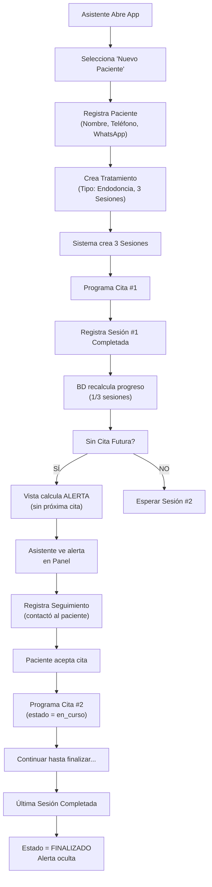

# Design Document: Gestión de Continuidad de Tratamientos Odontológicos

## Overview

Este documento describe la arquitectura técnica, modelo de datos y componentes para implementar el feature "Gestión de Continuidad de Tratamientos Odontológicos" en DentiFlow.

**Objetivo**: Permitir que la asistente gestione el ciclo completo de tratamientos multi-sesión, desde el registro del paciente hasta la identificación automática de tratamientos que requieren seguimiento.

---


## Correctness Properties

### CP1: Integridad de Sesiones
- Property: sesiones_completadas nunca debe exceder total_sesiones_planificadas
- Enforcement: CHECK constraint + validación en aplicación
- Verification: TEST que intente actualizar sesiones_completadas > total

### CP2: Estado Consistente de Tratamientos
- Property: Si sesiones_completadas = total_sesiones, estado debe ser 'finalizado'
- Enforcement: Trigger automático al actualizar sesiones
- Verification: Query que encuentre inconsistencias

### CP3: Citas Futuras Validas
- Property: fecha_hora_fin > fecha_hora_inicio
- Enforcement: CHECK constraint
- Verification: TEST que intente crear cita inválida

### CP4: RLS Enforcement
- Property: Datos solo accesibles por usuarios autorizados
- Enforcement: RLS policies en PostgreSQL
- Verification: TEST login como diferentes roles

## Error Handling

### Errores de Validación
- Teléfono inválido → Mostrar mensaje "Formato de teléfono inválido (8-15 dígitos)"
- Fecha pasada → "No puede programar cita en fecha pasada"
- Sesiones > Total → "No puede completar más sesiones de las planificadas"

### Errores de Base de Datos
- Foreign key violation → "Paciente o tratamiento no encontrado"
- RLS violation → "No tiene permisos para acceder a este recurso"
- Connection error → Reintentar automáticamente, mostrar modal

### Errores de Lógica de Negocio
- Tratamiento sin sesiones → Prevenir eliminación
- Paciente con tratamientos activos → No permitir eliminar paciente

## Testing Strategy

### Pruebas Unitarias
- Funciones de cálculo (progreso de tratamiento)
- Validación de formatos (teléfono, email)
- Transformación de datos

### Pruebas de Integración
- CRUD completo de tratamientos
- Detección automática de tratamientos pendientes
- Actualización de sesiones y progreso

### Pruebas E2E
- Flujo completo: Registrar paciente → Crear tratamiento → Completar sesión → Ver alerta
- Cambios de estado (en_curso → finalizado)
- RLS (acceso por rol)
## Architecture

### 2.1 Stack Tecnológico

```
┌─────────────────────────────────────────────────────────────┐
│                    FRONTEND (React + TS)                    │
│  ├─ Pages (Pacientes, Citas, Tratamientos, Seguimientos)   │
│  ├─ Components (Formularios, Tablas, Alertas)              │
│  └─ Hooks (usePacientes, useTratamientos, etc.)            │
└────────────────────────┬────────────────────────────────────┘
                         │ (HTTPS REST API)
┌────────────────────────▼────────────────────────────────────┐
│            SUPABASE (Backend as a Service)                  │
│  ├─ Supabase Auth (Autenticación)                          │
│  ├─ PostgreSQL Database                                     │
│  │  ├─ pacientes                                            │
│  │  ├─ citas                                                │
│  │  ├─ tratamientos                                         │
│  │  ├─ sesiones_tratamientos                               │
│  │  └─ seguimientos_pacientes                              │
│  ├─ RLS Policies (Row Level Security)                      │
│  ├─ Real-time Subscriptions                                │
│  └─ Edge Functions (Lógica del servidor)                   │
└─────────────────────────────────────────────────────────────┘
```
### 2.2 Flujo de Datos

```
Usuario (Asistente/Doctora)
        ↓
React Component
        ↓
Supabase Client (TypeScript SDK)
        ↓
Supabase API
        ↓
PostgreSQL Database + RLS
        ↓
Datos filtrados por rol
```
---

## Data Models

### 3.1 Tablas Principales

#### **Tabla: usuarios (perfiles administrativos)**

SPEC-001 debe crear esta tabla **antes de SPEC-002**, asociada 1:1 a Supabase Auth. `nombre_completo` es el dato de presentación utilizado en el historial. La fuente de autorización sigue siendo exclusivamente el claim protegido `app_metadata.rol`; el campo `rol` en `usuarios` es solo informativo y no concede privilegios.

```sql
CREATE TABLE IF NOT EXISTS public.usuarios (
  id UUID PRIMARY KEY REFERENCES auth.users(id) ON DELETE RESTRICT,
  nombre_completo TEXT NOT NULL CHECK (length(btrim(nombre_completo)) >= 2),
  correo_electronico TEXT,
  activo BOOLEAN NOT NULL DEFAULT true,
  created_at TIMESTAMPTZ NOT NULL DEFAULT NOW(),
  updated_at TIMESTAMPTZ NOT NULL DEFAULT NOW()
);

ALTER TABLE public.usuarios ENABLE ROW LEVEL SECURITY;
CREATE POLICY usuarios_select_personal ON public.usuarios
FOR SELECT TO authenticated
USING ((auth.jwt() -> 'app_metadata' ->> 'rol') IN ('asistente','doctora'));
-- Sólo el backend administrativo con privilegios suficientes crea/edita perfiles.
-- Nunca otorgar UPDATE/INSERT/DELETE de usuarios al cliente autenticado.
REVOKE INSERT, UPDATE, DELETE ON public.usuarios FROM authenticated, anon;
```

Los perfiles deben aprovisionarse mediante una operación administrativa protegida, después de crear el usuario en Supabase Auth. Nunca permitir que un usuario se asigne o modifique su propio rol. La lectura del nombre de los usuarios habilitados es válida para un consultorio único; en una versión multi-clínica se requiere aislamiento adicional.

#### **Tabla: pacientes**

```sql
CREATE TABLE pacientes (
  id UUID PRIMARY KEY DEFAULT gen_random_uuid(),
  nombre_completo TEXT NOT NULL,
  telefono TEXT NOT NULL CONSTRAINT pacientes_telefono_check CHECK (telefono ~ '^[0-9]{8,15}$'),
  telefono_whatsapp TEXT CONSTRAINT pacientes_whatsapp_check CHECK (telefono_whatsapp IS NULL OR telefono_whatsapp ~ '^[0-9]{8,15}$'),
  correo_electronico TEXT,
  acepta_comunicaciones_whatsapp BOOLEAN DEFAULT false,
  fecha_registro DATE DEFAULT CURRENT_DATE,
  estado TEXT DEFAULT 'activo' CONSTRAINT pacientes_estado_check CHECK (estado IN ('activo', 'inactivo')),
  created_at TIMESTAMPTZ DEFAULT NOW(),
  updated_at TIMESTAMPTZ DEFAULT NOW(),
  
  CONSTRAINT pacientes_nombre_minlength CHECK (LENGTH(nombre_completo) >= 2)
);

CREATE INDEX idx_pacientes_nombre ON pacientes(nombre_completo);
CREATE INDEX idx_pacientes_telefono ON pacientes(telefono);
CREATE INDEX idx_pacientes_estado ON pacientes(estado);
```
#### **Tabla: citas**

```sql
CREATE TABLE citas (
  id UUID PRIMARY KEY DEFAULT gen_random_uuid(),
  paciente_id UUID NOT NULL REFERENCES pacientes(id) ON DELETE RESTRICT,
  fecha_hora_inicio TIMESTAMPTZ NOT NULL,
  fecha_hora_fin TIMESTAMPTZ,
  duracion_minutos INTEGER NOT NULL DEFAULT 60 CHECK (duracion_minutos > 0),
  estado TEXT DEFAULT 'programada' CONSTRAINT citas_estado_check 
    CHECK (estado IN ('programada', 'completada', 'cancelada', 'no_asistio')),
  motivo TEXT,
  observaciones_administrativas TEXT,
  created_at TIMESTAMPTZ DEFAULT NOW(),
  updated_at TIMESTAMPTZ DEFAULT NOW(),
  
  CONSTRAINT citas_hora_valida CHECK (fecha_hora_fin IS NULL OR fecha_hora_fin > fecha_hora_inicio)
);

CREATE INDEX idx_citas_paciente_id ON citas(paciente_id);
CREATE INDEX idx_citas_fecha_hora ON citas(fecha_hora_inicio);
CREATE INDEX idx_citas_estado ON citas(estado);
```
#### **Tabla: tratamientos**

```sql
CREATE TABLE tratamientos (
  id UUID PRIMARY KEY DEFAULT gen_random_uuid(),
  paciente_id UUID NOT NULL REFERENCES pacientes(id) ON DELETE RESTRICT,
  tipo_tratamiento TEXT NOT NULL CONSTRAINT tratamientos_tipo_check 
    CHECK (tipo_tratamiento IN ('Endodoncia', 'Ortodoncia', 'Limpieza', 'Otros')),
  descripcion_administrativa TEXT,
  fecha_inicio DATE,
  total_sesiones_planificadas INTEGER NOT NULL CONSTRAINT tratamientos_sesiones_check CHECK (total_sesiones_planificadas >= 1 AND total_sesiones_planificadas <= 100),
  sesiones_completadas INTEGER DEFAULT 0 CONSTRAINT tratamientos_completadas_check CHECK (sesiones_completadas >= 0),
  fecha_ultima_sesion DATE,
  fecha_proxima_sesion DATE,
  fecha_finalizacion DATE,
  fecha_suspension TIMESTAMPTZ,
  fecha_abandono TIMESTAMPTZ,
  estado TEXT DEFAULT 'pendiente_iniciar' CONSTRAINT tratamientos_estado_check 
    CHECK (estado IN ('pendiente_iniciar', 'en_curso', 'pendiente_seguimiento', 'finalizado', 'suspendido', 'abandonado')),
  created_at TIMESTAMPTZ DEFAULT NOW(),
  updated_at TIMESTAMPTZ DEFAULT NOW(),
  
  CONSTRAINT tratamientos_sesiones_logica CHECK (sesiones_completadas <= total_sesiones_planificadas)
);

CREATE INDEX idx_tratamientos_paciente_id ON tratamientos(paciente_id);
CREATE INDEX idx_tratamientos_estado ON tratamientos(estado);
CREATE INDEX idx_tratamientos_fecha_ultima ON tratamientos(fecha_ultima_sesion);
```
#### **Tabla: sesiones_tratamientos**

```sql
CREATE TABLE sesiones_tratamientos (
  id UUID PRIMARY KEY DEFAULT gen_random_uuid(),
  tratamiento_id UUID NOT NULL REFERENCES tratamientos(id) ON DELETE RESTRICT,
  cita_id UUID REFERENCES citas(id) ON DELETE SET NULL,
  numero_sesion INTEGER NOT NULL CONSTRAINT sesiones_numero_check CHECK (numero_sesion >= 1),
  fecha_programada DATE,
  fecha_realizacion DATE,
  estado TEXT DEFAULT 'pendiente' CONSTRAINT sesiones_estado_check 
    CHECK (estado IN ('pendiente', 'completada', 'cancelada', 'reprogramada')),
  observacion_administrativa TEXT,
  CONSTRAINT sesiones_numero_unico UNIQUE(tratamiento_id, numero_sesion),
  created_at TIMESTAMPTZ DEFAULT NOW(),
  updated_at TIMESTAMPTZ DEFAULT NOW()
);

CREATE INDEX idx_sesiones_tratamiento_id ON sesiones_tratamientos(tratamiento_id);
CREATE INDEX idx_sesiones_cita_id ON sesiones_tratamientos(cita_id);
CREATE INDEX idx_sesiones_numero ON sesiones_tratamientos(numero_sesion);
CREATE INDEX idx_sesiones_estado ON sesiones_tratamientos(estado);
```
#### **Tabla: seguimientos_pacientes**

```sql
CREATE TABLE seguimientos_pacientes (
  id UUID PRIMARY KEY DEFAULT gen_random_uuid(),
  paciente_id UUID NOT NULL REFERENCES pacientes(id) ON DELETE RESTRICT,
  tratamiento_id UUID REFERENCES tratamientos(id) ON DELETE SET NULL,
  fecha_seguimiento TIMESTAMPTZ NOT NULL DEFAULT NOW(),
  medio_contacto TEXT CONSTRAINT seguimientos_medio_check 
    CHECK (medio_contacto IN ('telefono', 'whatsapp', 'presencial', 'correo')),
  motivo_seguimiento TEXT,
  resultado TEXT CONSTRAINT seguimientos_resultado_check 
    CHECK (resultado IN ('contacto_exitoso', 'sin_respuesta', 'numero_invalido', 'paciente_rechaza')),
  proxima_fecha_seguimiento DATE,
  observacion_administrativa TEXT,
  estado TEXT DEFAULT 'pendiente' CONSTRAINT seguimientos_estado_check 
    CHECK (estado IN ('pendiente', 'completado', 'cancelado')),
  created_at TIMESTAMPTZ DEFAULT NOW(),
  updated_at TIMESTAMPTZ DEFAULT NOW()
);

CREATE INDEX idx_seguimientos_paciente_id ON seguimientos_pacientes(paciente_id);
CREATE INDEX idx_seguimientos_tratamiento_id ON seguimientos_pacientes(tratamiento_id);
CREATE INDEX idx_seguimientos_estado ON seguimientos_pacientes(estado);
CREATE INDEX idx_seguimientos_fecha ON seguimientos_pacientes(fecha_seguimiento);
```
### 3.2 Triggers para Actualización Automática

```sql
-- Función para actualizar updated_at
CREATE OR REPLACE FUNCTION update_updated_at_column()
RETURNS TRIGGER AS $$
BEGIN
  NEW.updated_at = NOW();
  RETURN NEW;
END;
$$ language 'plpgsql';

-- Aplicar trigger a todas las tablas
CREATE TRIGGER usuarios_updated_at BEFORE UPDATE ON usuarios
  FOR EACH ROW EXECUTE FUNCTION update_updated_at_column();

CREATE TRIGGER pacientes_updated_at BEFORE UPDATE ON pacientes
  FOR EACH ROW EXECUTE FUNCTION update_updated_at_column();

CREATE TRIGGER citas_updated_at BEFORE UPDATE ON citas
  FOR EACH ROW EXECUTE FUNCTION update_updated_at_column();

CREATE TRIGGER tratamientos_updated_at BEFORE UPDATE ON tratamientos
  FOR EACH ROW EXECUTE FUNCTION update_updated_at_column();

CREATE TRIGGER sesiones_tratamientos_updated_at BEFORE UPDATE ON sesiones_tratamientos
  FOR EACH ROW EXECUTE FUNCTION update_updated_at_column();

CREATE TRIGGER seguimientos_pacientes_updated_at BEFORE UPDATE ON seguimientos_pacientes
  FOR EACH ROW EXECUTE FUNCTION update_updated_at_column();
```
### 3.2.1 Validaciones de sesiones y transiciones de tratamiento

Los `CHECK` no pueden consultar otra tabla. Por eso `numero_sesion` y la pertenencia de la cita al mismo paciente requieren un trigger real, y no un `CHECK` que aparente cubrirlos.

```sql
CREATE OR REPLACE FUNCTION public.validar_sesion_tratamiento()
RETURNS trigger LANGUAGE plpgsql SET search_path = '' AS $$
DECLARE v_total integer; v_paciente uuid; v_paciente_cita uuid;
BEGIN
  SELECT total_sesiones_planificadas, paciente_id INTO v_total, v_paciente
  FROM public.tratamientos WHERE id = NEW.tratamiento_id;
  IF v_total IS NULL OR NEW.numero_sesion > v_total THEN
    RAISE EXCEPTION 'Número de sesión fuera del rango del tratamiento';
  END IF;
  IF NEW.estado = 'completada' AND NEW.fecha_realizacion IS NULL THEN
    RAISE EXCEPTION 'La fecha de realización es obligatoria para una sesión completada';
  END IF;
  IF NEW.cita_id IS NOT NULL THEN
    SELECT paciente_id INTO v_paciente_cita FROM public.citas WHERE id = NEW.cita_id;
    IF v_paciente_cita IS DISTINCT FROM v_paciente THEN
      RAISE EXCEPTION 'La cita no pertenece al paciente del tratamiento';
    END IF;
  END IF;
  RETURN NEW;
END;
$$;
CREATE TRIGGER trg_validar_sesion
BEFORE INSERT OR UPDATE ON public.sesiones_tratamientos
FOR EACH ROW EXECUTE FUNCTION public.validar_sesion_tratamiento();

CREATE OR REPLACE FUNCTION public.validar_estado_tratamiento()
RETURNS trigger LANGUAGE plpgsql SET search_path = '' AS $$
DECLARE v_reales integer;
BEGIN
  IF NEW.estado = 'finalizado'
     AND NEW.sesiones_completadas <> NEW.total_sesiones_planificadas THEN
    RAISE EXCEPTION 'No puede finalizar un tratamiento con sesiones pendientes';
  END IF;
  IF TG_OP = 'UPDATE' THEN
    IF NEW.sesiones_completadas IS DISTINCT FROM OLD.sesiones_completadas THEN
      SELECT count(*)::integer INTO v_reales
      FROM public.sesiones_tratamientos
      WHERE tratamiento_id = NEW.id AND estado = 'completada';
      IF NEW.sesiones_completadas <> v_reales THEN
        RAISE EXCEPTION 'El progreso debe coincidir con las sesiones completadas';
      END IF;
    END IF;
    IF NEW.estado IS DISTINCT FROM OLD.estado THEN
      IF NEW.estado = 'suspendido' THEN
        NEW.fecha_suspension := now();
      ELSIF NEW.estado = 'abandonado' THEN
        NEW.fecha_abandono := now();
      ELSIF NEW.estado IN ('en_curso','pendiente_iniciar','pendiente_seguimiento') THEN
        NEW.fecha_suspension := NULL;
        NEW.fecha_abandono := NULL;
      END IF;
    END IF;
  END IF;
  RETURN NEW;
END;
$$;
CREATE TRIGGER trg_validar_estado_tratamiento
BEFORE INSERT OR UPDATE ON public.tratamientos
FOR EACH ROW EXECUTE FUNCTION public.validar_estado_tratamiento();
```

**Orden de despliegue:** crear primero tablas, después validaciones de sesión/estado, después trigger de recálculo y, finalmente, vistas y RLS. Probar sesión repetida, números fuera de rango y cita asignada a otro paciente.

### 3.3 Políticas RLS (Row Level Security)

Los roles provienen de `auth.users.raw_app_meta_data`, administrado únicamente mediante privilegios de servidor; en el JWT se consultan mediante `auth.jwt() -> 'app_metadata' ->> 'rol'`. El alcance actual es **un único consultorio**.

```sql
ALTER TABLE public.pacientes ENABLE ROW LEVEL SECURITY;
ALTER TABLE public.citas ENABLE ROW LEVEL SECURITY;
ALTER TABLE public.tratamientos ENABLE ROW LEVEL SECURITY;
ALTER TABLE public.sesiones_tratamientos ENABLE ROW LEVEL SECURITY;
ALTER TABLE public.seguimientos_pacientes ENABLE ROW LEVEL SECURITY;

-- No hay políticas FOR ALL ni permisos DELETE directos desde la aplicación.
-- Las operaciones de baja son cambios de estado administrativos cuando proceda.
DO $$
DECLARE tabla TEXT;
BEGIN
  FOREACH tabla IN ARRAY ARRAY[
    'pacientes','citas','tratamientos',
    'sesiones_tratamientos','seguimientos_pacientes'
  ] LOOP
    EXECUTE format('CREATE POLICY %I ON public.%I FOR SELECT TO authenticated USING ((auth.jwt() -> ''app_metadata'' ->> ''rol'') IN (''asistente'', ''doctora''))', tabla || '_select_personal', tabla);
    EXECUTE format('CREATE POLICY %I ON public.%I FOR INSERT TO authenticated WITH CHECK ((auth.jwt() -> ''app_metadata'' ->> ''rol'') = ''asistente'')', tabla || '_insert_asistente', tabla);
    EXECUTE format('CREATE POLICY %I ON public.%I FOR UPDATE TO authenticated USING ((auth.jwt() -> ''app_metadata'' ->> ''rol'') = ''asistente'') WITH CHECK ((auth.jwt() -> ''app_metadata'' ->> ''rol'') = ''asistente'')', tabla || '_update_asistente', tabla);
    EXECUTE format('REVOKE DELETE ON public.%I FROM authenticated, anon', tabla);
  END LOOP;
END;
$$;
```

Estas políticas restringen operaciones por rol; las validaciones de transiciones y la integridad referencial deben imponerse además con constraints, triggers y/o funciones transaccionales. Comprobar los permisos de doctora (lectura), asistente (lectura/escritura), usuario sin rol (denegado) y anónimo (denegado).

### 3.4 Exclusión de citas superpuestas por paciente

La consulta de disponibilidad del frontend no protege contra peticiones concurrentes. Para este consultorio se define una restricción de exclusión en la tabla `citas` que impide dos intervalos simultáneos **del mismo paciente** con estado `programada`, `completada` o `no_asistio` (no en citas canceladas). Se aplica desde SPEC-001, tanto a creación como a reprogramación (SPEC-002).

```sql
CREATE EXTENSION IF NOT EXISTS btree_gist;
ALTER TABLE public.citas
  ADD CONSTRAINT citas_sin_solapamiento_paciente
  EXCLUDE USING gist (
    paciente_id WITH =,
    tstzrange(
      fecha_hora_inicio,
      COALESCE(fecha_hora_fin,
        fecha_hora_inicio + (COALESCE(duracion_minutos,60) * INTERVAL '1 minute')),
      '[)'
    ) WITH &&
  ) WHERE (estado IN ('programada', 'completada', 'no_asistio'));
```

**Precondiciones:** ejecutar en una migración versionada antes de cargar datos; auditar y resolver citas previas que se solapen y garantizar duración positiva, incluso cuando `fecha_hora_fin` sea nula. La restricción no impide reservas simultáneas de *pacientes diferentes*, pues el alcance original no define salas o sillones; si se requiere evitar doble reserva del consultorio completo, deberá especificarse por separado. Probar inserciones concurrentes; PostgreSQL debe rechazar una de ellas con violación de exclusión (`23P01`).


## 4. Queries Principales

### 4.1 Detección Automática de Tratamientos Pendientes de Seguimiento

```sql
-- Alerta por tratamiento (no por cualquier cita del mismo paciente).
-- Solo se consideran futuras las citas VINCULADAS a sesiones del tratamiento.
CREATE OR REPLACE VIEW public.v_tratamientos_sin_cita_futura
WITH (security_invoker = true) AS
SELECT t.id, t.paciente_id, p.nombre_completo, t.tipo_tratamiento,
       t.total_sesiones_planificadas, t.sesiones_completadas,
       t.fecha_ultima_sesion,
       CASE WHEN t.fecha_ultima_sesion IS NULL THEN NULL
            ELSE ((now() AT TIME ZONE 'America/Managua')::date - t.fecha_ultima_sesion)
       END AS dias_sin_sesion
FROM public.tratamientos t
JOIN public.pacientes p ON p.id = t.paciente_id
WHERE t.sesiones_completadas < t.total_sesiones_planificadas
  AND t.estado NOT IN ('finalizado','suspendido','abandonado')
  AND NOT EXISTS (
    SELECT 1
    FROM public.sesiones_tratamientos st
    JOIN public.citas c ON c.id = st.cita_id
    WHERE st.tratamiento_id = t.id
      AND st.estado <> 'completada'
      AND c.estado = 'programada'
      AND c.fecha_hora_inicio > now()
  )
ORDER BY t.fecha_ultima_sesion ASC NULLS FIRST;
GRANT SELECT ON public.v_tratamientos_sin_cita_futura TO authenticated;
```

La vista `public.v_tratamientos_sin_cita_futura` se crea explícitamente arriba con `security_invoker=true`; probar que hereda RLS correctamente en Supabase/PostgreSQL 15 o posterior.

Este resultado es **calculado al consultar**, de modo que una cita vencida dispara una alerta aunque no se haya ejecutado una tarea cron. La interfaz puede marcar un tratamiento como `pendiente_seguimiento` mediante una operación controlada, pero no debe confiar solamente en un estado almacenado para detectar los vencimientos.


### 4.2 Actualizar Estado de Tratamiento Después de Completar Sesión

**Contrato transaccional obligatorio:** la interfaz **no** debe incrementar `sesiones_completadas` por separado después de actualizar la sesión: ese patrón causa doble conteo si hay reintentos o peticiones simultáneas. Se implementará un trigger en PostgreSQL que recalcule el progreso desde las sesiones realmente completadas, después de insertar o modificar una sesión.

```sql
CREATE OR REPLACE FUNCTION public.recalcular_progreso_tratamiento(p_tratamiento_id uuid)
RETURNS void LANGUAGE plpgsql SET search_path = '' AS $$
DECLARE
  v_total integer;
  v_completadas integer;
  v_ultima date;
  v_estado text;
BEGIN
  SELECT total_sesiones_planificadas, estado
    INTO v_total, v_estado
  FROM public.tratamientos WHERE id = p_tratamiento_id FOR UPDATE;
  IF NOT FOUND THEN RETURN; END IF;
  SELECT count(*)::integer, max(fecha_realizacion)
    INTO v_completadas, v_ultima
  FROM public.sesiones_tratamientos
  WHERE tratamiento_id = p_tratamiento_id AND estado = 'completada';
  IF v_completadas > v_total THEN
    RAISE EXCEPTION 'Las sesiones completadas exceden el total del tratamiento';
  END IF;
  UPDATE public.tratamientos
  SET sesiones_completadas = v_completadas,
      fecha_ultima_sesion = v_ultima,
      estado = CASE
        WHEN v_completadas = v_total THEN 'finalizado'
        WHEN v_estado IN ('suspendido','abandonado') THEN v_estado
        WHEN v_completadas > 0 THEN 'en_curso'
        ELSE 'pendiente_iniciar'
      END,
      fecha_finalizacion = CASE WHEN v_completadas = v_total
        THEN COALESCE(fecha_finalizacion, (now() AT TIME ZONE 'America/Managua')::date)
        ELSE NULL END
  WHERE id = p_tratamiento_id;
END;
$$;

CREATE OR REPLACE FUNCTION public.actualizar_progreso_desde_sesion()
RETURNS trigger LANGUAGE plpgsql SET search_path = '' AS $$
BEGIN
  IF TG_OP = 'UPDATE' AND NEW.tratamiento_id <> OLD.tratamiento_id THEN
    RAISE EXCEPTION 'No se permite reasignar una sesión a otro tratamiento';
  END IF;
  IF TG_OP = 'DELETE' THEN
    PERFORM public.recalcular_progreso_tratamiento(OLD.tratamiento_id);
  ELSE
    PERFORM public.recalcular_progreso_tratamiento(NEW.tratamiento_id);
  END IF;
  RETURN NULL;
END;
$$;

CREATE TRIGGER trg_recalcular_progreso
AFTER INSERT OR UPDATE OR DELETE ON public.sesiones_tratamientos
FOR EACH ROW EXECUTE FUNCTION public.actualizar_progreso_desde_sesion();
```

**Precondiciones de implementación:** comprobar que `numero_sesion` pertenece al rango del tratamiento, que `fecha_realizacion` se guarda al completar y que, si `cita_id` está presente, su paciente coincide con el paciente del tratamiento. Aplicar comprobaciones en trigger/operación controlada además de los `CHECK` existentes. Para estados suspendido/abandonado, conservar trazabilidad de fechas `fecha_suspension` y `fecha_abandono` mediante un trigger de transición. Validar contra Supabase antes del despliegue. El frontend actualizará solo la sesión y refrescará tratamiento y alertas.


## Components and Interfaces

### 5.1 Estructura de Carpetas

```
src/
├── components/
│   ├── Pacientes/
│   │   ├── ListaPacientes.tsx
│   │   ├── FormularioPaciente.tsx
│   │   └── DetallePaciente.tsx
│   ├── Tratamientos/
│   │   ├── ListaTratamientos.tsx
│   │   ├── FormularioTratamiento.tsx
│   │   └── ProgressoTratamiento.tsx
│   ├── Sesiones/
│   │   ├── ListaSesiones.tsx
│   │   └── FormularioSesion.tsx
│   ├── Seguimientos/
│   │   ├── PanelAlertas.tsx
│   │   ├── FormularioSeguimiento.tsx
│   │   └── HistorialSeguimientos.tsx
│   └── Common/
│       ├── Header.tsx
│       ├── Sidebar.tsx
│       └── Badge.tsx
├── hooks/
│   ├── usePacientes.ts
│   ├── useTratamientos.ts
│   ├── useSesiones.ts
│   └── useSeguimientos.ts
├── types/
│   └── database.ts
└── pages/
    ├── PacientesPage.tsx
    ├── TratamientosPage.tsx
    └── SeguimientosPage.tsx
```
### 5.2 Componente Ejemplo: Panel de Alertas

```typescript
// src/components/Seguimientos/PanelAlertas.tsx
import React, { useEffect, useState } from 'react';
import { ExclamationTriangleIcon } from '@heroicons/react/24/outline';
import { supabase } from '@/lib/supabase';

interface TratamientoPendiente {
  id: string;
  paciente_id: string;
  nombre_paciente: string;
  tipo_tratamiento: string;
  sesiones_completadas: number;
  total_sesiones_planificadas: number;
  dias_sin_sesion: number;
}

export function PanelAlertas() {
  const [alertas, setAlertas] = useState<TratamientoPendiente[]>([]);
  const [loading, setLoading] = useState(true);

  useEffect(() => {
    cargarAlertas();
  }, []);

  const cargarAlertas = async () => {
    const { data, error } = await supabase
      .from('v_tratamientos_sin_cita_futura')
      .select('*')
      .order('fecha_ultima_sesion', { ascending: true });

    if (!error && data) {
      setAlertas(data.map(t => ({
        id: t.id,
        paciente_id: t.paciente_id,
        nombre_paciente: t.nombre_completo,
        tipo_tratamiento: t.tipo_tratamiento,
        sesiones_completadas: t.sesiones_completadas,
        total_sesiones_planificadas: t.total_sesiones_planificadas,
        dias_sin_sesion: t.dias_sin_sesion ?? 0,
      })));
    }
    setLoading(false);
  };

  return (
    <div className="bg-white rounded-lg shadow-sm border border-gray-200 p-6">
      <div className="flex items-center mb-4">
        <ExclamationTriangleIcon className="h-6 w-6 text-yellow-600 mr-2" />
        <h2 className="text-lg font-semibold text-gray-900">
          Tratamientos que Requieren Seguimiento
        </h2>
      </div>

      {loading ? (
        <p className="text-gray-500">Cargando alertas...</p>
      ) : alertas.length === 0 ? (
        <p className="text-green-600">Todos los tratamientos tienen seguimiento programado ✓</p>
      ) : (
        <div className="space-y-3">
          {alertas.map(alerta => (
            <div 
              key={alerta.id} 
              className="bg-yellow-50 border-l-4 border-yellow-500 p-4 rounded"
            >
              <p className="font-semibold text-yellow-900">
                {alerta.nombre_paciente}
              </p>
              <p className="text-sm text-yellow-800 mt-1">
                {alerta.tipo_tratamiento}: {alerta.sesiones_completadas}/{alerta.total_sesiones_planificadas} sesiones
              </p>
              <p className="text-xs text-yellow-700 mt-1">
                Sin sesión por {alerta.dias_sin_sesion} días
              </p>
            </div>
          ))}
        </div>
      )}
    </div>
  );
}
```
---

## 6. Flujo de Usuario Principal


---

## 7. Consideraciones de Seguridad

### 7.1 Validación en Frontend
- Validar formato de teléfono antes de enviar
- Validar que sesiones_completadas ≤ total_sesiones
- Validar estados permitidos

### 7.2 Validación en Backend (PostgreSQL)
- CHECK constraints en todas las columnas críticas
- Foreign keys con ON DELETE RESTRICT
- Triggers para evitar inconsistencias

### 7.3 RLS Policies
- Asistente: puede leer y modificar todas las tablas
- Doctora: solo lectura (SELECT)
- Acceso restringido por roles; el MVP contempla un solo consultorio, sin aislamiento multi-clínica

---

## 8. Próximas Fases (Fuera de Alcance Actual)

1. **Integración Google Calendar**: Sincronizar citas con Google Calendar
2. **Automatización WhatsApp**: Enviar recordatorios y seguimientos automáticos
3. **Dashboard con KPIs**: Métricas de asistencia y abandonos
4. **Reportes Avanzados**: Exportar a Excel/CSV

---

## 9. Referencias

- Supabase Docs: https://supabase.com/docs
- PostgreSQL Check Constraints: https://www.postgresql.org/docs/current/ddl-constraints.html
- React Hook Form: https://react-hook-form.com/

